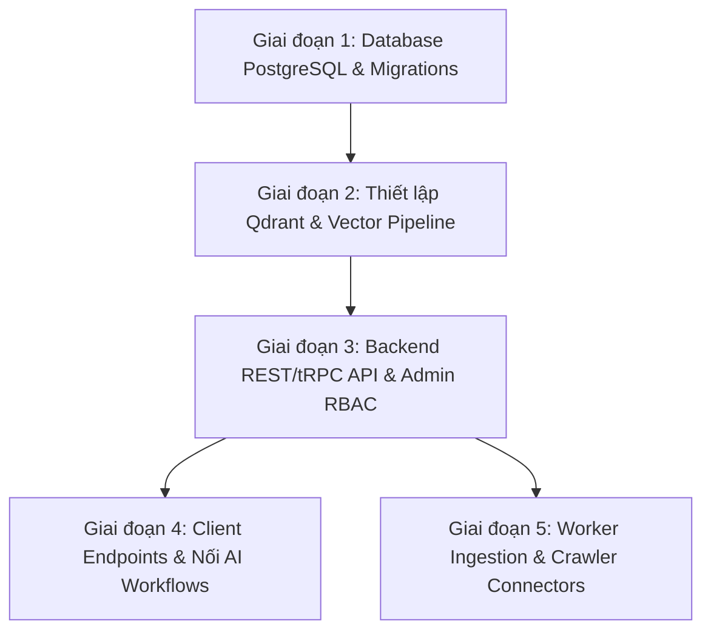

# TỔNG HỢP CÁC VIỆC ĐÃ LÀM VÀ KẾ HOẠCH TRIỂN KHAI TIẾP THEO

> **Dự án:** Hệ thống Tư vấn Laptop/Điện thoại & Săn deal thông minh (Hybrid RAG + Multi-Agent)  
> **Cập nhật ngày:** 14/11/2026  
> **Mục đích:** Báo cáo chi tiết hiện trạng các thành phần đã hoàn tất và xây dựng roadmap kỹ thuật chuẩn bị cho các bước tiếp theo.

---

## PHẦN 1: TỔNG QUAN HIỆN TRẠNG DỰ ÁN

Hệ thống được thiết kế theo kiến trúc chuẩn doanh nghiệp phục vụ bài toán tư vấn mua sắm có kiểm chứng và săn deal:
- **Tầng dữ liệu:** PostgreSQL (Source of Truth) + Qdrant (Vector Database cho Hybrid RAG).
- **Tầng nghiệp vụ & AI:** TypeScript Module (`src/ai`), LangGraph orchestration, OpenAI ChatGPT API cho structured output.
- **Nguyên tắc cốt lõi đã thiết lập:** 
  - **Zero-Hallucination & Hard Verification:** Không tự ý xuất bản dữ liệu cào; mọi claim đo lường phải có nguồn (`source_name`, `source_url`, `measured_at`). Nếu thiếu dữ liệu kiểm chứng, hệ thống bắt buộc trả về chuỗi quy chuẩn `Chưa có dữ liệu kiểm chứng cho đúng phiên bản này.`
  - **Ranh giới phân quyền rõ ràng:** Module `src/ai` hoạt động như một domain library thuần túy (chỉ đọc catalog, không chạy INSERT/UPDATE/DELETE, không chứa HTTP route hay auth/RBAC). Backend server sẽ sở hữu quyền ghi DB, migrations, API routes và phân quyền.

---

## PHẦN 2: CHI TIẾT CÁC CÔNG VIỆC ĐÃ HOÀN THÀNH (DONE)

Toàn bộ lõi AI orchestration, schema validation, RAG retriever và guardrails trong thư mục [`src/ai`](file:///D:/Coding/test/src/ai) đã hoàn thành 100%, vượt qua typecheck (`npx tsc --noEmit` sạch 100%) và vượt qua toàn bộ **29/29 unit tests & eval tests** (`npm run test:ai`).

### 1. Bề mặt Public Module AI ([`src/ai/index.ts`](file:///D:/Coding/test/src/ai/index.ts))
Đã đóng gói và export chuẩn hóa đúng **6 hàm nghiệp vụ chính**:
1. **`resolveCrawledEntity`** ([`src/ai/workflows/crawled-entity.ts`](file:///D:/Coding/test/src/ai/workflows/crawled-entity.ts)):
   - Giải quyết thực thể cào được từ các sàn/web (TGDĐ, CellphoneS, Phong Vũ...).
   - Đối chiếu chính xác SKU, tên model, linh kiện phần cứng (CPU, GPU, RAM, màn hình).
   - Tự động phát hiện bất thường: lệch linh kiện so với tên máy, giá lệch > 25% so với `price_histories`, thiếu phí bắt buộc (shipping, VAT).
   - **Tuyệt đối không auto-publish:** Luôn trả về trạng thái `pending_review` và gắn cờ `anomaly_flags` để Admin phê duyệt.
2. **`synthesizeReviewEvidence`** ([`src/ai/workflows/review-evidence.ts`](file:///D:/Coding/test/src/ai/workflows/review-evidence.ts)):
   - Bóc tách bài review/đo kiểm thực tế thành 4 nhóm: *hiệu năng thực tế*, *nhiệt độ/độ ồn*, *pin thực dùng*, *lỗi vặt/điểm trừ*.
   - So sánh cấu hình bài review với cấu hình gốc của `variant_id` (CPU, GPU, RAM, kích thước/độ phân giải màn hình).
   - Tự động gắn cờ `version_mismatch_warning = true` nếu bài test chạy trên linh kiện khác bản đang bán.
   - Luôn lưu ở trạng thái `pending_review`.
3. **`runConversationalPicker`** ([`src/ai/workflows/conversational-picker.ts`](file:///D:/Coding/test/src/ai/workflows/conversational-picker.ts)):
   - Luồng tư vấn chọn máy theo mục đích sử dụng, ngân sách và cấu hình tối thiểu.
   - **Budget Lock:** Tuyệt đối không tự ý vượt ngân sách người dùng xác nhận (`max_budget_vnd`).
   - Nếu thông tin chưa đầy đủ hoặc người dùng cần nới ngân sách, bot trả về trạng thái `AWAITING_CONFIRMATION` thay vì tự quyết.
4. **`evaluateProactiveNudge`** ([`src/ai/workflows/proactive-nudge.ts`](file:///D:/Coding/test/src/ai/workflows/proactive-nudge.ts)):
   - Gợi ý điểm mù cấu hình (ví dụ: màn hình sai màu 45% NTSC, RAM hàn chết không nâng cấp được, sạc chậm).
   - **Deterministic Gate:** Chạy kiểm tra dữ liệu trước LLM; nếu không có bằng chứng đo kiểm ⇒ trả về `{ should_show: false }`, **tốn 0 token**.
   - **Cache Context:** Khóa cache `(variant_id, trigger_type, goal_hash)` với TTL 10 phút, ngăn chặn gọi LLM trùng lặp.
   - **Compact Prompt:** Nén payload dưới 400 token (chỉ truyền tóm tắt variant và tối đa 2 bằng chứng).
5. **`explainComparisonTradeoffs`** ([`src/ai/workflows/comparison.ts`](file:///D:/Coding/test/src/ai/workflows/comparison.ts)):
   - Tạo ma trận so sánh trade-off giữa 2–3 phiên bản máy.
   - Trích xuất thông số thật từ DB + bằng chứng đo kiểm đã duyệt (`status = 'approved'`).
   - LLM chỉ tóm tắt đánh đổi dựa trên dữ liệu thật; bị guardrail kiểm duyệt chặt chẽ.
6. **`analyzeExternalQuote`** ([`src/ai/workflows/external-quote.ts`](file:///D:/Coding/test/src/ai/workflows/external-quote.ts)):
   - Thẩm định báo giá từ bên thứ ba do người dùng paste vào.
   - Khớp chính xác dòng máy, kiểm tra cấu hình phần cứng và so sánh với giá thị trường + lịch sử giá trong DB.

---

### 2. Các tầng phòng vệ Guardrails & Chống Hallucination ([`src/ai/tools/claim-guard.ts`](file:///D:/Coding/test/src/ai/tools/claim-guard.ts))
- **Hardware Token Guard:** Trích xuất toàn bộ token phần cứng trong văn bản LLM sinh ra (RTX/GTX/Radeon, Core/Ryzen/Apple M, RAM/VRAM GB, Wh, kg, Hz, inch, độ phân giải) và đối chiếu với DB. Nếu LLM tự "chế" ra linh kiện lạ, câu trả lời bị hủy và thay bằng văn bản deterministic an toàn.
- **Price Guard:** Ngăn chặn tuyệt đối việc LLM tự sinh giá ảo không có trong bảng `offers` hoặc `price_histories`.
- **Strict Citations:** Bắt buộc mọi đánh giá đo lường phải kèm theo `source_name`, `source_url`, `measured_at`.

---

### 3. Tầng Dữ liệu Contract & Hybrid RAG ([`src/ai/types/db.types.ts`](file:///D:/Coding/test/src/ai/types/db.types.ts), [`src/ai/rag/hybrid.ts`](file:///D:/Coding/test/src/ai/rag/hybrid.ts), [`src/ai/qdrant/payload.ts`](file:///D:/Coding/test/src/ai/qdrant/payload.ts))
- **PostgreSQL là Source of Truth:**
  - Định nghĩa contract dữ liệu hoàn chỉnh cho 9 bảng (`product_models`, `product_variants`, `stores`, `offers`, `price_histories`, `evidences_and_reviews`, `staging_crawled_items`, `error_reports`, `admin_users` & `audit_logs`).
  - Mọi câu truy vấn nghiệp vụ đều hard-filter: `v.status = 'published'`, `m.status = 'published'`, `v.merged_into_id IS NULL`, `e.status = 'approved'`, `o.status = 'active'`, `o.total_known_price_vnd IS NOT NULL`.
- **Hybrid RAG Retriever:**
  - Truy vấn Qdrant bắt buộc áp bộ lọc `status = 'approved'`, `variant_id IN (...)`, `sku_code IN (...)`.
  - Kết quả vector được đối chiếu ngược lại với bản ghi PostgreSQL đã approved: nếu point trong Qdrant còn tồn tại nhưng trong PostgreSQL đã bị admin xóa hoặc hủy duyệt, kết quả lập tức bị loại bỏ (chống stale vector).

---

### 4. Kết quả Kiểm thử Nghiệm thu (Test Suites)
- **`src/ai/__tests__/ai-eval.test.ts`** (16 tests): Kiểm tra zero-hallucination, budget lock, deterministic nudge gate, GPU mismatch flagging, external quote verification, exact SKU resolution, hybrid RAG payload validation, SQL hard-filtering, cache context.
- **`src/ai/agents/agents.test.ts`** (10 tests): Kiểm thử logic Entity Resolution Agent (lệch cấu hình, lệch giá >25%, thiếu phí) và Review Synthesis Agent (bóc tách 4 nhóm, cảnh báo lệch RAM/GPU/display).
- **`src/ai/qdrant/payload.test.ts`** (3 tests): Kiểm thử cấu trúc payload vector, filter SKU exact, point ID UUID v5 đồng nhất giữa Node.js và Python.
- Toàn bộ **29 test PASSED** (thời gian chạy ~1.5s).

---

## PHẦN 3: KẾ HOẠCH CHI TIẾT CÁC CÔNG VIỆC TIẾP THEO (ROADMAP)

Dựa trên bản đặc tả MVP và kiến trúc hệ thống, các công việc tiếp theo được chia thành 5 giai đoạn triển khai:

---

### GIAI ĐOẠN 1: DATABASE POSTGRESQL & MIGRATIONS (Ưu tiên cao nhất)

Mục tiêu: Xây dựng cơ sở dữ liệu vật lý hoàn chỉnh trên PostgreSQL dựa theo đúng contract tại [`src/ai/types/db.types.ts`](file:///D:/Coding/test/src/ai/types/db.types.ts).

1. **Khởi tạo công cụ Migration:**
   - Lựa chọn công nghệ: Drizzle ORM, Prisma, hoặc SQL migration thuần (Flyway/node-pg-migrate). Khuyến nghị **Drizzle ORM** hoặc **Prisma** để tận dụng TypeScript type-safety tương thích với module AI hiện tại.
2. **Triển khai DDL cho 9 bảng cốt lõi:**
   - [ ] `product_models`: Tách riêng dòng máy (id, category, brand, name, series, release_year, status).
   - [ ] `product_variants`: Từng mã cấu hình cụ thể (id, model_id, sku_code UNIQUE, region, cpu, gpu, ram_gb, ram_type, ram_upgradable, storage_gb, storage_slots, display_size, display_res, display_panel, color_gamut, refresh_rate, battery_wh, weight_kg, os, specs_json, status, merged_into_id).
   - [ ] `stores`: Đại lý/cửa hàng (id, name, website, shipping_regions, warranty_policy, return_policy, is_verified).
   - [ ] `offers`: Tin bán/Deal (id, variant_id, store_id, listed_price_vnd, mandatory_fees_vnd, total_known_price_vnd, conditional_price_vnd, promo_conditions, stock_status, product_condition, source_url, is_sponsored, checked_at, expires_at, status).
   - [ ] `price_histories`: Biến động giá (id, offer_id, variant_id, store_id, price_vnd, recorded_at).
   - [ ] `evidences_and_reviews`: Dữ liệu đo kiểm thực tế (id, model_id, variant_id, source_name, source_url, evidence_type, summary_performance, summary_thermals_noise, summary_battery, summary_cons_quirks, raw_excerpt, measured_at, status).
   - [ ] `staging_crawled_items`: Vùng đệm cào thô (id, source_id, raw_title, raw_specs_json, raw_price, raw_url, matched_variant_id, confidence_score, anomaly_flags jsonb, review_status).
   - [ ] `error_reports`: Phản hồi báo sai từ người dùng (id, variant_id, offer_id, report_type, description, evidence_url, status, resolved_by, created_at).
   - [ ] `admin_users` & `audit_logs`: Quản trị viên (email, role: `catalog_editor` | `data_moderator` | `ops` | `super_admin`) và nhật ký ghi vết chỉnh sửa/duyệt.
3. **Tối ưu hóa Index & Constraints:**
   - B-tree Index: `(model_id, status)`, `(variant_id, status)`, `(sku_code)`, `(store_id, variant_id)`, `price_histories(variant_id, recorded_at DESC)`.
   - GIN Index: `specs_json` trên `product_variants`, `anomaly_flags` trên `staging_crawled_items`.
4. **Seed Data:**
   - Seed tài khoản admin mẫu theo 4 role.
   - Seed dữ liệu catalog mẫu (10 dòng laptop phổ biến: Dell XPS, Lenovo Legion, Macbook Air, Asus ROG...) kèm các biến thể SKU chính xác để phục vụ test integration.

---

### GIAI ĐOẠN 2: THIẾT LẬP QDRANT & PIPELINE VECTOR

Mục tiêu: Đưa Qdrant vào hoạt động đồng bộ với PostgreSQL.

1. **Khởi tạo Qdrant Collection:**
   - Tên collection: `product_evidences`.
   - Vector params: Kích thước vector (ví dụ 1536 cho `text-embedding-3-small` hoặc 768/384 cho local embedder), khoảng cách Cosine.
   - Tạo Payload Indexes trên Qdrant: `model_id` (keyword), `variant_id` (keyword), `sku_code` (keyword), `status` (keyword).
2. **Triển khai Sync Worker (Event-driven):**
   - Viết service lắng nghe sự kiện khi Admin duyệt review (`evidences_and_reviews.status` chuyển thành `approved`):
     - Gọi LLM/Embedding API tạo vector cho các trường `summary_performance`, `summary_thermals_noise`, `summary_battery`, `summary_cons_quirks`.
     - Upsert điểm vector vào Qdrant kèm payload đầy đủ 6 trường bắt buộc: `evidence_id`, `model_id`, `variant_id`, `sku_code`, `source_url`, `measured_at`, `status = 'approved'`.
   - Nếu Admin chuyển trạng thái review sang `rejected` hoặc xóa: Lập tức gọi lệnh xóa point tương ứng trên Qdrant.

---

### GIAI ĐOẠN 3: BACKEND REST / TRPC API & ADMIN RBAC

Mục tiêu: Xây dựng hệ thống API cho Admin kiểm duyệt dữ liệu theo đúng BRD.

1. **Khung ứng dụng Backend (Server Setup):**
   - Lựa chọn Node.js/TypeScript framework (Fastify hoặc NestJS).
   - Thiết lập Authentication (JWT / Session) và Middleware kiểm tra quyền RBAC:
     - `catalog_editor`: Quản lý model, variant, gộp/tách SKU.
     - `data_moderator`: Duyệt tin cào (`staging_crawled_items`), duyệt review (`evidences_and_reviews`), xử lý `error_reports`.
     - `ops`: Quản lý store, offer, bật/tắt `ai_fallback_enabled`.
     - `super_admin`: Toàn quyền và quản lý user admin.
2. **Các API Admin cốt lõi:**
   - [ ] **STT 23 - Duyệt Staging Crawled Items:**
     - `GET /admin/staging`: Danh sách tin cào kèm bộ lọc theo `anomaly_flags` (lệch giá, thiếu phí, lệch cấu hình).
     - `POST /admin/staging/:id/approve`: Duyệt tin cào vào `offers` chính thức.
     - `POST /admin/staging/:id/reject`: Từ chối/bỏ qua tin cào.
     - `POST /admin/staging/:id/remap`: Gán thủ công tin cào vào một `variant_id` khác.
   - [ ] **STT 22, 24 - Quản lý Models & Variants:**
     - CRUD `product_models` và `product_variants`.
     - Chức năng gộp bản trùng: Cập nhật `merged_into_id` để trỏ về variant chuẩn.
     - Chức năng tách biến thể: Tách SKU khi phát hiện khác biệt linh kiện.
   - [ ] **STT 25 - Quản lý Stores & Offers:**
     - CRUD cửa hàng, cập nhật chính sách bảo hành, đổi trả.
     - Toggle trạng thái deal (`active`, `hidden`, `expired`).
   - [ ] **STT 26 - Duyệt Bằng chứng & Reviews:**
     - `GET /admin/evidences/pending`: Danh sách review cần duyệt kèm cảnh báo lệch linh kiện `version_mismatch_warning`.
     - `POST /admin/evidences/:id/approve`: Duyệt review (kích hoạt đồng bộ sang Qdrant).
     - `POST /admin/evidences/:id/reject`: Từ chối review.
   - [ ] **STT 30 - Xử lý Báo cáo sai lệch (Error Reports):**
     - `GET /admin/error-reports`: Xem danh sách user report lỗi thông số/giá.
     - `PATCH /admin/error-reports/:id`: Cập nhật trạng thái `verified_fixed` / `rejected`, lưu `resolved_by`.
   - [ ] **STT 31, 32 - Audit Logs & Ops Settings:**
     - `GET /admin/audit-logs`: Truy vết hành động chỉnh sửa/duyệt.
     - `GET/PUT /admin/ops/settings/ai-fallback`: Bật/tắt chế độ fallback AI khẩn cấp.

---

### GIAI ĐOẠN 4: CLIENT ENDPOINTS & TÍCH HỢP MODULE AI

Mục tiêu: Đưa 6 hàm nghiệp vụ AI vào phục vụ giao diện người dùng (Web/Mobile App).

1. **Khởi tạo Production Dependencies:**
   - Cung cấp `PostgresCatalogRepository` thật kết nối qua `pg.Pool`.
   - Cung cấp `QdrantVectorStore` thật gọi SDK Qdrant chính thức.
   - Cung cấp `OpenAiStructuredLlm` dùng API Key OpenAI thật.
   - Cung cấp `RedisNudgeCache` (thay cho in-memory cache) khi triển khai multi-instance.
2. **Xây dựng API Endpoints cho Client:**
   - [ ] `POST /api/chat/advisor`: Nhận message và lịch sử tư vấn, gọi `runConversationalPicker`. Hỗ trợ streaming UI.
   - [ ] `POST /api/catalog/nudge`: Khi user đang xem 1 variant, client gọi `evaluateProactiveNudge` để nhận popup cảnh báo điểm mù (nếu có).
   - [ ] `POST /api/compare/tradeoffs`: Gửi danh sách 2–3 `variant_id`, gọi `explainComparisonTradeoffs` để trả về bảng so sánh chi tiết.
   - [ ] `POST /api/quotes/analyze`: User nhập ảnh hoặc nội dung báo giá ngoài, gọi `analyzeExternalQuote` để thẩm định giá và cấu hình.
   - [ ] `POST /api/reports/submit`: Người dùng gửi báo sai thông tin giá/specs vào `error_reports`.

---

### GIAI ĐOẠN 5: CRAWLER CONNECTORS & BACKGROUND WORKERS

Mục tiêu: Tự động hóa quá trình thu thập dữ liệu giá và review.

1. **Crawler Workers:**
   - Viết scraper/crawler định kỳ cào giá laptop/điện thoại từ các sàn lớn (TGDĐ, CellphoneS, FPT Shop, Phong Vũ...).
   - Lưu dữ liệu cào thô vào bảng `staging_crawled_items`.
2. **Automated AI Ingestion Queue:**
   - Cronjob/Worker (BullMQ / Celery / Temporal) quét các bản ghi mới trong `staging_crawled_items`.
   - Chạy `resolveCrawledEntity` để phân tích và gắn cờ rủi ro `anomaly_flags`.
   - Tương tự, worker quét bài viết/video review mới -> chạy `synthesizeReviewEvidence` -> lưu vào `evidences_and_reviews` ở trạng thái `pending_review` chờ Admin duyệt.

---

## PHẦN 4: HÀNH ĐỘNG CẦN THỰC HIỆN NGAY BÂY GIỜ

Để bắt tay vào việc ngay, bạn hãy chọn bước muốn triển khai tiếp theo:

1. **Bắt đầu Giai đoạn 1 (Database Migration):**
   - Quyết định công cụ migration (Drizzle ORM / Prisma / SQL script).
   - Viết toàn bộ file DDL migration tạo 9 bảng và các index kèm file seed mẫu.
2. **Khởi tạo Backend Server (Giai đoạn 3):**
   - Dựng cấu trúc project backend (Fastify / NestJS / Express).
   - Thiết lập kết nối PostgreSQL Pool và wire-up với adapter `src/ai/data/postgres-catalog.ts`.
3. **Thiết lập hạ tầng (Docker Compose):**
   - Tạo file `docker-compose.yml` gồm PostgreSQL 16 (kèm cấu hình GIN/pgcrypto) và Qdrant vector database cục bộ để chạy test integration end-to-end.
