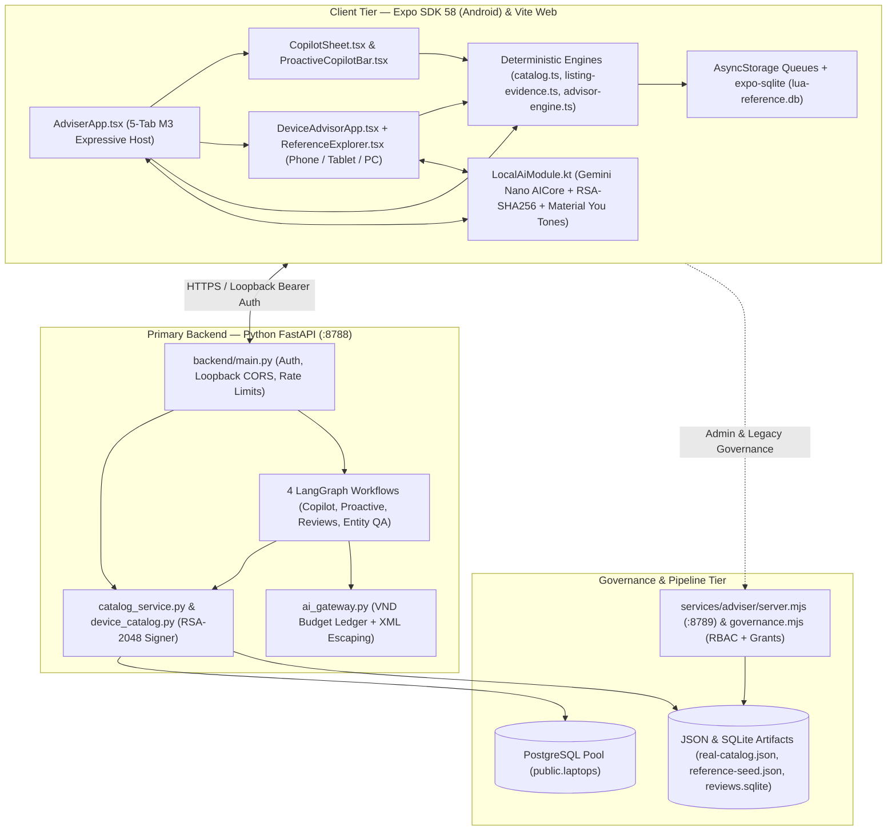
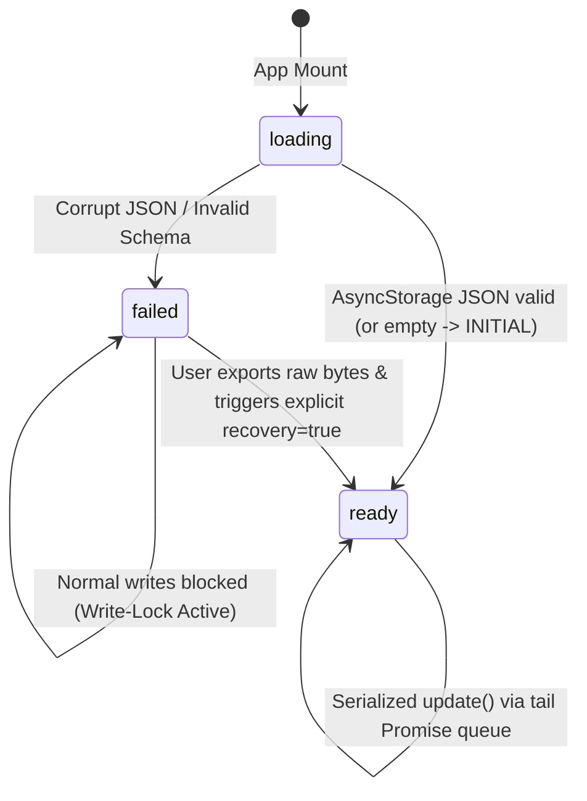
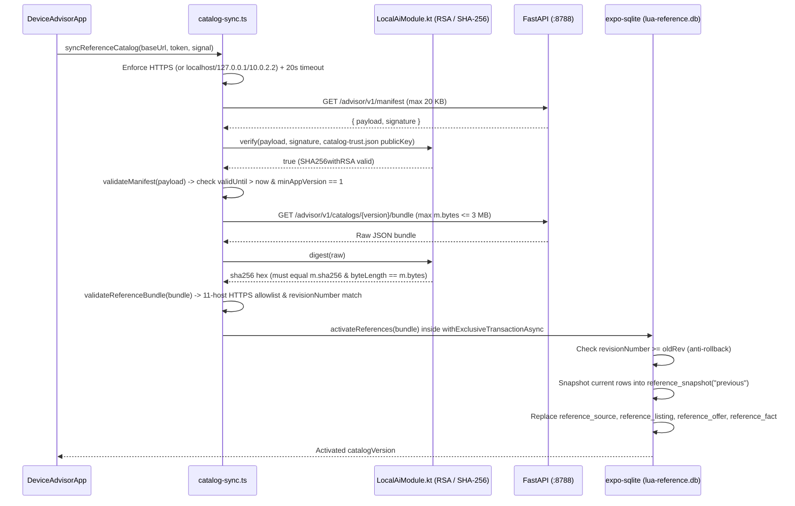
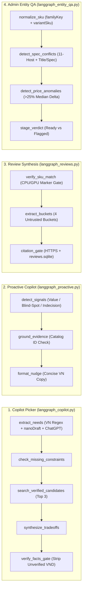
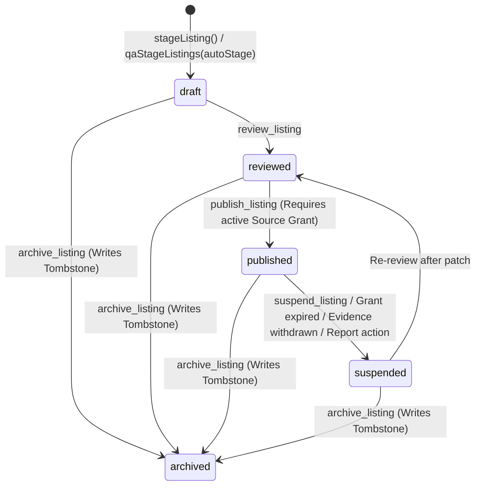

# Lựa Adviser v0.6.0 — UI/UX Research, Frontend & Backend Implementation Reference

> [!IMPORTANT]
> **Canonical Architecture Contract (`v0.6.0`):** Lựa Adviser is an evidence-first consumer electronics decision support system built for the Vietnamese market (`VN`). Every recommendation, price total, compatibility check, and AI-assisted explanation is strictly bounded by observed retailer/manufacturer evidence, deterministic rule engines, and explicit human confirmation gates.

---

## Table of Contents

1. [Executive Overview & Product Philosophy](#1-executive-overview--product-philosophy)
2. [Deep UI/UX Research & Material 3 Expressive Design System](#2-deep-uiux-research--material-3-expressive-design-system)
   - [2.1 Empirical Design Positioning](#21-empirical-design-positioning)
   - [2.2 Semantic Color System & Runtime WCAG Contrast Gate](#22-semantic-color-system--runtime-wcag-contrast-gate)
   - [2.3 Typography, Shape Morphing, Spacing & VND Formatting](#23-typography-shape-morphing-spacing--vnd-formatting)
   - [2.4 Card Information Hierarchy & Progressive Disclosure](#24-card-information-hierarchy--progressive-disclosure)
   - [2.5 Adaptive Layout & 4-Way Comparison Ergonomics](#25-adaptive-layout--4-way-comparison-ergonomics)
   - [2.6 Motion Physics, Reduced Motion & WCAG 2.2 AA Accessibility](#26-motion-physics-reduced-motion--wcag-22-aa-accessibility)
   - [2.7 AI-UX Trust & Calibration Audit (Part V Taxonomy)](#27-ai-ux-trust--calibration-audit-part-v-taxonomy)
   - [2.8 Next-Horizon UI/UX Recommendations](#28-next-horizon-uiux-recommendations)
3. [Frontend Architecture & Implementation (`apps/adviser/`)](#3-frontend-architecture--implementation-appsadviser)
   - [3.1 Runtime Stack & Dual-Target Build Pipeline](#31-runtime-stack--dual-target-build-pipeline)
   - [3.2 Unified Dual-Surface Architecture & Module Map](#32-unified-dual-surface-architecture--module-map)
   - [3.3 Deterministic Domain & Interval Utility Scoring Engines](#33-deterministic-domain--interval-utility-scoring-engines)
   - [3.4 State Persistence, Concurrency Queues & Corruption Recovery](#34-state-persistence-concurrency-queues--corruption-recovery)
   - [3.5 Cryptographically Signed SQLite Catalog Sync & Rollback](#35-cryptographically-signed-sqlite-catalog-sync--rollback)
   - [3.6 Native Kotlin Bridge (`LocalAiModule.kt`)](#36-native-kotlin-bridge-localaimodulekt)
4. [Backend, Hybrid LangGraph AI & Governance Implementation](#4-backend-hybrid-langgraph-ai--governance-implementation)
   - [4.1 FastAPI Service & Security Middleware (`backend/main.py`)](#41-fastapi-service--security-middleware-backendmainpy)
   - [4.2 Dual Catalog Data Layer, PostgreSQL Pool & RSA-2048 Bundle Publisher](#42-dual-catalog-data-layer-postgresql-pool--rsa-2048-bundle-publisher)
   - [4.3 Shared OpenAI Gateway, VND Budget Ledger & Prompt-Injection Defense](#43-shared-openai-gateway-vnd-budget-ledger--prompt-injection-defense)
   - [4.4 Hybrid LangGraph `StateGraph` Agents (Online + Offline Parity)](#44-hybrid-langgraph-stategraph-agents-online--offline-parity)
   - [4.5 Node.js Governance, RBAC & Source-Use Grant Service (`services/adviser/`)](#45-nodejs-governance-rbac--source-use-grant-service-servicesadviser)
   - [4.6 Data Ingestion Pipeline & Automated Verification Matrix](#46-data-ingestion-pipeline--automated-verification-matrix)

---

## 1. Executive Overview & Product Philosophy

Conventional electronics marketplaces optimize for impulse conversion through artificial urgency timers, opaque "AI match %" scores, and buried configuration caveats (such as soldered 8 GB RAM or 45% NTSC panels). **Lựa Adviser** inverts that model around five non-negotiable engineering invariants documented across [UNIFIED_APP.md](file:///e:/test/apps/adviser/UNIFIED_APP.md) and Stage Gates [G1_DECISION_PACK.md](file:///e:/test/docs/decisions/G1_DECISION_PACK.md) through [G5_DECISION_PACK.md](file:///e:/test/docs/decisions/G5_DECISION_PACK.md):

1. **Zero Fabrication (`BR-07`):** Models (both online `LangGraph + ChatGPT` and on-device `Gemini Nano`) never invent product SKUs, prices, specifications, stock states, or benchmark claims. Every AI output passes through a deterministic post-generation gate that strips unverified VND figures or restricts output to pre-computed fact keys.
2. **Human Confirmation Before Mutation (`BR-02`):** Neither free-text extraction nor conversational AI may silently overwrite the buyer's active `Requirements` or `DeviceProfile`. Proposed changes are staged with `requiresConfirmation: true` until the user explicitly taps confirm.
3. **Honest Uncertainty & Conflict Isolation (`EVIDENCE-01/02`):** When a retailer listing title (`"16GB/512GB"`) contradicts structured metadata (`ram: 8`), the engine refuses to guess either value — nulling out the conflicted attribute and surfacing a visible discrepancy alert. Missing shipping or mandatory fees leave total purchase cost in `UNKNOWN` (`null`) rather than equating sticker price with checkout total.
4. **Hybrid Online + Offline Continuity:** Online deployments combine `LangGraph` `StateGraph` orchestration and `ChatGPT` (`gpt-4o-mini`) over FastAPI (`:8788`), while offline/disconnected usage degrades seamlessly to on-device `ML Kit GenAI Prompt` (`Gemini Nano`) and deterministic TypeScript scoring over bundled or SQLite-synced catalogs.
5. **Cryptographic & Governance Provenance:** Reference bundles are signed with **RSA-2048 (`SHA256withRSA`)** with monotonic `revisionNumber` anti-rollback and 30-day `validUntil` expiry; catalog publication is governed by explicit retailer source-use grants, RBAC roles, and archive tombstones.

---

## 2. Deep UI/UX Research & Material 3 Expressive Design System

### 2.1 Empirical Design Positioning

Cross-referencing [MATERIAL_3_EXPRESSIVE_RESEARCH.md](file:///e:/test/docs/design/MATERIAL_3_EXPRESSIVE_RESEARCH.md), [FRONTEND_MOTION_SPEC.md](file:///e:/test/docs/design/FRONTEND_MOTION_SPEC.md), and the `ui-ux-pro-max` consumer-electronics benchmark yields four foundational UX decisions:

- **Swiss Grid Clarity + Material 3 Expressive Tonal Warmth:** Hardware specification comparison is cognitively dense (`F.1.1.02` Cognitive Load). Lựa pairs high-contrast typographic hierarchy and generous card padding (`20dp`–`24dp`) with an organic forest-green semantic palette (`#245f43` light / `#9ed6b1` dark) that signals financial prudence and calm editorial neutrality rather than aggressive flash-sale red/orange.
- **Zero-Emoji Vector Iconography:** Primary navigation and card chrome rely on crisp 24×24 SVG stroke primitives ([NavigationIcon.tsx](file:///e:/test/apps/adviser/src/NavigationIcon.tsx#L1-L30) and [icons.tsx](file:///e:/test/apps/adviser/src/icons.tsx)) with `strokeWidth={1.8}`, keeping visual noise low while screen readers read semantic `accessibilityLabel` strings.
- **Focal-Point Scannability:** Product cards place **observed VND price (`28sp`, `fontWeight: "800"`, `tabular-nums`)** as the primary numeric anchor, immediately followed by a structured **2×2 hardware pill grid (`CPU`, `GPU`, `RAM`, `SSD`)** so buyers never hunt through unstructured paragraphs to distinguish an `i5 / 8GB` SKU from an `i7 / 16GB` SKU.
- **Explicit Epistemic Humility:** Every price carries an observation age indicator (`observationAgeLabel()` in [catalog.ts](file:///e:/test/apps/adviser/src/catalog.ts#L592-L607)), flagging observations `>= 30` days old as stale and separating historical sticker price from unverified checkout totals.

### 2.2 Semantic Color System & Runtime WCAG Contrast Gate

Color tokens are centralized in [expressive-theme.ts](file:///e:/test/apps/adviser/src/expressive-theme.ts#L1-L25) and provided through [AdvisorTheme.tsx](file:///e:/test/apps/adviser/src/AdvisorTheme.tsx#L10-L52) and [useExpressiveTheme.ts](file:///e:/test/apps/adviser/src/useExpressiveTheme.ts#L6-L34).

| Semantic Token | Light Mode (`EXPRESSIVE_LIGHT`) | Dark Mode (`EXPRESSIVE_DARK`) | Primary UI Role | Verified Contrast Behavior |
|---|---|---|---|---|
| `bg` | `#f3f6ee` | `#101b18` | App canvas, secondary button resting fill | Base canvas luminance anchor |
| `card` | `#ffffff` | `#1d2d27` | Elevated product cards, sheets, table cells | `text` on `card` > `12:1` (AAA) |
| `container` | `#dcebdd` | `#304e3b` | Spec pills, active comparison diff row, filter chips | Paired with `onContainer` (`>= 4.5:1`) |
| `onContainer` | `#173c27` | `#d2f0da` | High-legibility foreground on tonal containers | Validated `>= 4.5:1` vs `container` |
| `text` | `#193127` | `#e3eee7` | Headings, product titles, primary table values | Validated `>= 4.5:1` vs `bg` & `card` |
| `muted` | `#50675b` | `#a5b9ac` | Metadata, observation timestamps, helper labels | Validated `>= 4.5:1` vs `bg` & `card` |
| `accent` | `#245f43` | `#9ed6b1` | Primary CTAs, focal VND prices, active tab pill, focus ring | Paired with `onAccent` (`>= 4.5:1`) |
| `onAccent` | `#ffffff` | `#163323` | Primary button text, rank badges (`#1 Đề xuất`) | Validated `>= 4.5:1` vs `accent` |
| `line` | `#687d70` | `#8ba394` | Card borders, input outlines, table dividers | Validated `>= 3.0:1` vs `bg` & `card` |
| `error` | `#a32932` | `#ffb3b9` | Spec conflict alerts, form validation errors | Paired with `accessibilityRole="alert"` |

> [!TIP]
> **Fail-Safe Material You Dynamic Color Gate:** On Android 12+ (`SDK_INT >= 31`), `AdviserThemeModule.scheme(dark)` ([LocalAiModule.kt](file:///e:/test/apps/adviser/native/adviser/LocalAiModule.kt#L99-L122)) extracts user wallpaper tones (`system_neutral1_*`, `system_accent1_*`, `system_accent2_*`). Before applying them, [theme-validation.ts](file:///e:/test/apps/adviser/src/theme-validation.ts#L2-L35) computes exact sRGB relative luminance ($L = 0.2126 R + 0.7152 G + 0.0722 B$) across 6 text pairs (`>= 4.5:1`) and 2 border pairs (`>= 3.0:1`). Any OEM palette that fails WCAG 2.2 AA is automatically rejected in favor of `EXPRESSIVE_LIGHT` / `EXPRESSIVE_DARK`.

For embedded multi-category screens inside [DeviceAdvisorApp.tsx](file:///e:/test/apps/adviser/src/DeviceAdvisorApp.tsx#L16-L17) and [ReferenceExplorer.tsx](file:///e:/test/apps/adviser/src/ReferenceExplorer.tsx#L12), `legacyPalette(colors)` ([AdvisorTheme.tsx](file:///e:/test/apps/adviser/src/AdvisorTheme.tsx#L37-L52)) maps the active `ExpressiveColors` roles onto legacy `surface`/`primary`/`secondary` keys so both surfaces share one coherent visual theme without maintaining divergent palettes (superseding standalone [design-tokens.ts](file:///e:/test/apps/adviser/src/design-tokens.ts)).

### 2.3 Typography, Shape Morphing, Spacing & VND Formatting

Defined in [expressive-theme.ts](file:///e:/test/apps/adviser/src/expressive-theme.ts#L26-L66) and [i18n.ts](file:///e:/test/apps/adviser/src/i18n.ts#L120-L136):

- **Typographic Hierarchy (`EXPRESSIVE_TYPE`):**
  - `display`: `32sp / 40sp`, weight `900` — Hero headlines (`"Máy nào hợp việc của bạn?"`)
  - `headline`: `28sp / 36sp`, weight `800` — Primary sheet titles & focal card prices
  - `title`: `22sp / 30sp`, weight `800` — Modal headers
  - `section`: `20sp / 28sp`, weight `800` — Product card titles (`accessibilityRole="header"`)
  - `body`: `16sp / 25sp`, weight `400` (`1.56x` line height for Vietnamese diacritic legibility)
  - `label`: `15sp / 22sp`, weight `700` — Interactive button and chip copy
  - `caption`: `14sp / 20sp`, weight `400` — Spec pills, provenance footnotes (never drops below `14sp` for body metadata)
- **Purposeful Shape Scale & Morphing (`EXPRESSIVE_SHAPE`):**
  - `hero: 36dp`, `card: 28dp`, `dialog: 28dp`, `button: 24dp`, `selected: 16dp`, `field: 14dp`.
  - When a button, filter pill, or segmented tab transitions from unselected to `selected`, `ExpressiveButton` animates its `borderRadius` from `24dp` (pill-like) to `16dp` (squircle) alongside a `✓` prefix and `2dp` accent border — communicating selection through **shape + text + fill** rather than color alone.
- **Tabular Vietnamese Currency (`formatVnd` & `formatVndDigits`):**
  - All currency displays apply `fontVariant: ["tabular-nums"]` and format safe integers with Vietnamese dot thousand-separators (`25.000.000 ₫`).
  - Budget and quotation `TextInput` fields ([AdviserApp.tsx](file:///e:/test/apps/adviser/src/AdviserApp.tsx#L2260-L2270), [ListingTools.tsx](file:///e:/test/apps/adviser/src/ListingTools.tsx#L68-L73)) apply live `formatVndDigits()` as the user types (`25000000` → `25.000.000`), preventing off-by-ten-million entry mistakes common in 8-digit VND figures (`I.1.1.03` Error Prevention).

### 2.4 Card Information Hierarchy & Progressive Disclosure

To prevent cognitive overload while preserving full technical transparency, product information is stratified across three progressive layers:

1. **Layer 1 — Discovery Card (`ListingCard` in [AdviserApp.tsx](file:///e:/test/apps/adviser/src/AdviserApp.tsx#L163-L450)):**
   - **Top Metadata Bar:** Optional rank pill (`Đề xuất #1`..`#3` when sorted by fit), `RetailerBadge` ([RetailerBadge.tsx](file:///e:/test/apps/adviser/src/RetailerBadge.tsx#L11-L118) mapping 11 retailer/manufacturer IDs to canonical Vietnamese names + 2–3 letter monograms like `FPT`, `TG`, `CPS`, `GVN`, `PV`), condition tag (`Máy cũ`), and observation age.
   - **Identity & Thumbnail:** 68×52 `contain` thumbnail (rendered only when `safeLink(v.thumbnail)` validates `https://`) beside product title and `brand · screen · weight` subtitle.
   - **Price Focal Block:** `28sp` tabular VND price, optional strikethrough `priceOriginal` + `-X%` pill, and installment note.
   - **2×2 Hardware Spec Grid (`specChips` in [listing-evidence.ts](file:///e:/test/apps/adviser/src/listing-evidence.ts#L93-L112)):** Four equal-prominence tonal chips (`CPU`, `GPU`, `RAM`, `SSD`) with `minWidth: "47%"`.
   - **Conflict / Fit Guidance & Dual CTA:** Red `accessibilityRole="alert"` banner if title vs spec disagrees; full card is pressable to open Detail, paired with explicit `Xem cấu hình` and `So sánh (N/4)` buttons.
2. **Layer 2 — `"Mua ngay"` Multi-Retailer & Variant Selector ([AdviserApp.tsx](file:///e:/test/apps/adviser/src/AdviserApp.tsx#L2547-L2649)):**
   - Rather than blindly redirecting out of the app, tapping `Mua ngay (K lựa chọn)` expands an inline comparison of sibling configurations and retailers (`relatedListings()` + `variantHardwareDiff()`), highlighting exact RAM/SSD/CPU/GPU deltas (`Khác biệt phần cứng: RAM 16 GB (so với 8 GB)`) alongside each retailer's verified `https://` store link.
3. **Layer 3 — 4-Tab Segmented Detail Sheet ([AdviserApp.tsx](file:///e:/test/apps/adviser/src/AdviserApp.tsx#L2651-L2878)):**
   - `Tổng quan`: Deterministic 6-part checked fact summary (`identity`, `price`, `cost`, `spec`, `fit`, `source`).
   - `Thông số chi tiết`: Structured 11-row key-value hardware table.
   - `Đánh giá & đo kiểm`: SKU-verified 4-bucket review synthesis (`Hiệu năng thực tế`, `Nhiệt độ & tiếng quạt`, `Thời lượng pin`, `Lưu ý / nhược điểm`) with source citation and check date.
   - `Nguồn & báo sai`: Selectable source URL plus 1-tap discrepancy reporting (`Sai cấu hình`, `Sai giá`, `Hết hàng`, `Hỏng liên kết`).

### 2.5 Adaptive Layout & 4-Way Comparison Ergonomics

Window width is observed dynamically via `useWindowDimensions()`, switching layout modes at the Android **Expanded (`840dp`)** breakpoint:

| Surface | Compact / Medium (`width < 840dp`) | Expanded Tablet / Desktop Web (`width >= 840dp`) |
|---|---|---|
| **Catalog Feed** | Single-column `FlatList` (`PAGE_SIZE = 12` incremental pagination) | 2-column CSS/Flex card grid |
| **Detail / Needs / Copilot Overlay** | Bottom-anchored modal sheet (`borderTopLeftRadius: 28dp`) | Right-aligned / centered dialog sheet (`maxWidth: 680dp`) |
| **Multi-Product Comparison ([ComparisonView.tsx](file:///e:/test/apps/adviser/src/ComparisonView.tsx))** | Fixed **`108dp` sticky left attribute column** + horizontally scrollable `188dp` product columns (`2..4` items) | Full **5-column matrix** (`148dp` attribute header + up to `4` equal-flex product columns) |

Additional comparison UX affordances in [ComparisonView.tsx](file:///e:/test/apps/adviser/src/ComparisonView.tsx#L144-L604) and [UnifiedComparison.tsx](file:///e:/test/apps/adviser/src/UnifiedComparison.tsx#L10-L161):
- **Automatic Difference Highlighting:** Attribute rows where `new Set(values).size > 1` switch background from `c.card` to `c.container` and promote cell typography to `fontWeight: "700"`.
- **In-Place Column Swap (`Đổi máy`):** Users can swap any single column (`swapComparisonColumn()` in [decision-state.ts](file:///e:/test/apps/adviser/src/decision-state.ts#L119-L129)) from a curated pool of up to 8 eligible catalog alternatives without losing their remaining comparison columns.
- **Neutral Budget Trade-Off Simulator (`Thêm ngân sách được gì?`):** Interactive `+2.000.000 ₫` and `+5.000.000 ₫` toggle pills run `budgetUpgradeCandidates()` to preview models excluded *solely* by budget ceiling — explicitly labeled `"tham khảo đánh đổi, không tự nới trần"`.

### 2.6 Motion Physics, Reduced Motion & WCAG 2.2 AA Accessibility

Motion tokens follow AndroidX Material 3 Expressive spring physics ([FRONTEND_MOTION_SPEC.md](file:///e:/test/docs/design/FRONTEND_MOTION_SPEC.md)), converting stiffness $k$, damping ratio $\zeta$, and mass $m$ into the viscous damping coefficient required by React Native Reanimated 4:

$$c = 2 \zeta \sqrt{k \cdot m}$$

- **Fast Spatial Spring (`EXPRESSIVE_SPRING` in [expressive-theme.ts](file:///e:/test/apps/adviser/src/expressive-theme.ts#L70-L74)):** $k = 800$, $\zeta = 0.6$, $m = 1 \implies c = 2(0.6)\sqrt{800} \approx 33.9411$. Drives `ExpressiveButton` press scale (`1.0` → `0.98`) and shape morphing (`24dp` → `16dp`).
- **Surface Entrance Spring ([ExpressiveSurface.tsx](file:///e:/test/apps/adviser/src/ExpressiveSurface.tsx#L19-L37)):** $k = 380$, $c = 31.19$, $m = 1$ ($\zeta \approx 0.8$), animating `opacity` (`0` → `1`) and `translateY` (`8dp` → `0dp`).
- **Lifecycle & Reduced-Motion Safety:**
  - `AdvisorTheme` initializes `reduceMotion = true` by default until `AccessibilityInfo.isReduceMotionEnabled()` resolves and subscribes to `reduceMotionChanged`. When enabled, springs are bypassed (`scale.value = 1`, `radius.value = target`) and active worklets are cancelled via `cancelAnimation()`.
  - `ExpressiveSurface` subscribes to `AppState` and immediately cancels animations + snaps `progress.value = 1` whenever the app backgrounds (`s !== "active"`), preventing stuck half-transparent views on resume.
- **Touch & Screen-Reader Ergonomics:**
  - Every interactive `Pressable`, chip, close icon, and text field enforces `minHeight: 48` and `minWidth: 48` (`Fitts's Law` / Android 48dp mandate).
  - The 5-destination icon-only bottom navigation bar ([AdviserApp.tsx](file:///e:/test/apps/adviser/src/AdviserApp.tsx#L2102-L2189)) uses `minHeight: 56`, `accessibilityRole="tablist"`, per-tab `accessibilityRole="tab"`, `accessibilityState={{ selected }}`, and dynamic screen-reader badge announcements (`"So sánh 3"` while keeping the visual numeric badge `accessible={false}` to avoid double-reading).
  - Comparison table cells expose composite `accessibilityLabel` strings (`"Máy 2 (ASUS Vivobook 15), RAM: 16 GB"`) so TalkBack/VoiceOver users never lose row/column coordinates during horizontal scroll.

### 2.7 AI-UX Trust & Calibration Audit (Part V Taxonomy)

Evaluated against the `ai-interface-reviewer` Part V taxonomy (44 principles across Conversational Flow, AI Transparency, Human Override, Contextual Timing, Source Citations, and Automation Bias Prevention):

| Part V AI-UX Dimension | Implementation in Lựa Adviser v0.6.0 | Code Evidence | Status |
|---|---|---|---|
| **AI Mode & Provenance Disclosure (`S.1.3`)** | Live mode banner explicitly distinguishes `"Trực tuyến · LangGraph + ChatGPT"`, `"Ngoại tuyến · Gemini Nano & Quy tắc"`, and `"Ngoại tuyến · Quy tắc kiểm chứng trên máy"`. | [CopilotSheet.tsx](file:///e:/test/apps/adviser/src/CopilotSheet.tsx#L278-L295) | Pass |
| **Human Override & Consent Gate (`BR-02`)** | Conversational AI and per-listing Q&A stage proposed filters in a separate review card (`"Áp dụng nhu cầu này"` / `"Đưa vào bản nháp để xem lại"`); `requiresConfirmation` is pinned to `true`. | [CopilotSheet.tsx](file:///e:/test/apps/adviser/src/CopilotSheet.tsx#L485-L518), [langgraph_copilot.py](file:///e:/test/backend/services/langgraph_copilot.py#L534) | Pass |
| **Live Extraction Transparency** | As the user types natural Vietnamese (`"dưới 22 triệu RAM 16GB mỏng nhẹ"`), real-time deterministic preview pills render `Trần: 22.000.000 ₫`, `RAM ≥ 16 GB`, `≤ 1.6 kg` *before* submission. | [CopilotSheet.tsx](file:///e:/test/apps/adviser/src/CopilotSheet.tsx#L199-L402) | Pass |
| **Contextual Timing, Cap & Dismissal** | `ProactiveCopilotBar` debounces remote checks by `500ms`, caps proactive nudges at **`MAX_SESSION_NUDGES = 3`** per session, supports per-nudge close (`×`), and offers 1-tap session mute (`"Tạm ẩn gợi ý"`). | [ProactiveCopilotBar.tsx](file:///e:/test/apps/adviser/src/ProactiveCopilotBar.tsx#L20-L225) | Pass |
| **Automation Bias Prevention** | Multi-category engine outputs explicit `[scoreLower, scoreUpper]` utility intervals and `evidenceCoverage` instead of opaque single-number scores; missing review buckets state `"Chưa có dữ liệu đo kiểm độc lập"`. | [advisor-engine.ts](file:///e:/test/apps/adviser/src/advisor-engine.ts#L350-L396), [langgraph_reviews.py](file:///e:/test/backend/services/langgraph_reviews.py#L30) | Pass |
| **User Cancellation & Elapsed Feedback** | Long-running AI calls display live elapsed seconds (`Đang phân tích & lọc máy (3s)…`) beside an immediate `Hủy` button that aborts both `fetch` (`AbortController`) and native AICore coroutines (`bridge.cancel()`). | [CopilotSheet.tsx](file:///e:/test/apps/adviser/src/CopilotSheet.tsx#L190-L430), [ListingTools.tsx](file:///e:/test/apps/adviser/src/ListingTools.tsx#L151-L164) | Pass |

### 2.8 Next-Horizon UI/UX Recommendations

1. **Web Bundle Route/Feature Code-Splitting:** Lazy-load `DeviceAdvisorApp` (`React.lazy`) in the Vite web target (`dist/demo.html` standalone target stays single-file by design, while standard multi-asset web hosting benefits from <300 KB initial chunks).
2. **Longitudinal Price Sparklines:** Once PostgreSQL `public.laptops` accumulates multi-week crawl snapshots per SKU, surface a compact 30-day SVG min/median/current sparkline inside the `Tổng quan` detail tab.
3. **Skeleton Shimmer Placeholders on Slow Networks:** Add reduced-motion-safe tonal placeholders while remote retailer `https://` thumbnails decode on cellular connections.
4. **Physical Handset TalkBack Sign-Off (`P09`):** Complete the external Gate G1 physical-device screen-reader timing checklist alongside emulator verification.

---

## 3. Frontend Architecture & Implementation (`apps/adviser/`)

### 3.1 Runtime Stack & Dual-Target Build Pipeline

Configured in [package.json](file:///e:/test/apps/adviser/package.json#L1-L65), [app.json](file:///e:/test/apps/adviser/app.json#L1-L32), and [vite.config.ts](file:///e:/test/apps/adviser/vite.config.ts#L1-L42):

- **Core Dependencies:** Expo SDK 58 (`expo@^58.0.25`), `react@19.3.0`, `react-native@0.88.1` (New Architecture and Android Edge-to-Edge enabled by default in SDK 58), `expo-sqlite@~58.0.17`, `@react-native-async-storage/async-storage@2.2.0`, `react-native-reanimated@4.7.1`, `react-native-svg@15.16.0`, `typescript@~6.0.3`.
- **Android Native / Expo Go Target:**
  - Bundled via Metro (`expo export --platform android` produces a 3.4 MB Hermes `.hbc` bundle across 1,139 modules).
  - Prebuild customization is automated via two Expo config plugins:
    1. [with-local-ai.cjs](file:///e:/test/apps/adviser/plugins/with-local-ai.cjs#L1-L68): Pins Kotlin `2.2.10` and `minSdkVersion 26`, injects `com.google.mlkit:genai-prompt:1.0.0-beta4`, copies `LocalAiModule.kt` into `app/src/main/java/vn/lua/adviser/`, and registers `LocalAiPackage()` in `MainApplication`.
    2. [with-local-network.cjs](file:///e:/test/apps/adviser/plugins/with-local-network.cjs#L1-L35): Enforces `android:usesCleartextTraffic="false"` and `android:allowBackup="false"`, writing `adviser_network_security.xml` so cleartext HTTP is permitted *strictly* to `localhost`, `127.0.0.1`, and `10.0.2.2` (Android emulator host loopback).
  - Explicitly blocks `READ_EXTERNAL_STORAGE`, `WRITE_EXTERNAL_STORAGE`, and `SYSTEM_ALERT_WINDOW` permissions in [app.json](file:///e:/test/apps/adviser/app.json#L21-L25).
- **Web / Standalone Demo Target (`vite build` + `scripts/standalone.mjs`):**
  - Resolves platform-specific `.web.tsx` / `.web.ts` shims ahead of native modules ([ExpressiveButton.web.tsx](file:///e:/test/apps/adviser/src/ExpressiveButton.web.tsx), `ExpressiveSurface.web.tsx`, `device-ai.web.ts`, `reference-storage.web.ts`), aliasing `react-native` to `react-native-web` and `@react-native/assets-registry/registry` to `react-native-web/dist/modules/AssetRegistry`.

### 3.2 Unified Dual-Surface Architecture & Module Map

At runtime, [App.tsx](file:///e:/test/apps/adviser/App.tsx) mounts [AdviserApp.tsx](file:///e:/test/apps/adviser/src/AdviserApp.tsx) wrapped in `AdvisorTheme` and `SafeAreaProvider`. Users can stay in the fast 5-tab laptop workflow or launch the embedded multi-category **Device Advisor** (`setDeviceAdvisorOpen(true)`), which renders `DeviceAdvisorApp` (`asFeature={true}`) without unmounting or losing host state.

| Layer | Key Modules | Primary Responsibility |
|---|---|---|
| **Host Surface & Navigation** | [AdviserApp.tsx](file:///e:/test/apps/adviser/src/AdviserApp.tsx), [NavigationIcon.tsx](file:///e:/test/apps/adviser/src/NavigationIcon.tsx), [RetailerBadge.tsx](file:///e:/test/apps/adviser/src/RetailerBadge.tsx) | 5-tab M3 Expressive host (`Tư vấn`, `Khám phá`, `So sánh`, `Đã lưu`, `Cài đặt`), paginated `FlatList`, 4-tab detail modal, `"Mua ngay"` variant sheet, quote intake, and hardware Back handling. |
| **Hybrid AI Surfaces** | [CopilotSheet.tsx](file:///e:/test/apps/adviser/src/CopilotSheet.tsx), [ProactiveCopilotBar.tsx](file:///e:/test/apps/adviser/src/ProactiveCopilotBar.tsx), [ListingTools.tsx](file:///e:/test/apps/adviser/src/ListingTools.tsx) | Conversational intake + Top-3 shortlist, non-blocking browsing nudges (`<= 3`/session), grounded per-listing Q&A, and buyer discrepancy reporting. |
| **Multi-Category Surface** | [DeviceAdvisorApp.tsx](file:///e:/test/apps/adviser/src/DeviceAdvisorApp.tsx), [ReferenceExplorer.tsx](file:///e:/test/apps/adviser/src/ReferenceExplorer.tsx), [UnifiedComparison.tsx](file:///e:/test/apps/adviser/src/UnifiedComparison.tsx) | 6-step structured elicitation (`category` → `purposes` → `budget` → `priorities` → `clarify` → `review`) across `Phone`, `Tablet`, and `PC` (`LAPTOP` / `DESKTOP`). |
| **Design System & Motion** | [expressive-theme.ts](file:///e:/test/apps/adviser/src/expressive-theme.ts), [AdvisorTheme.tsx](file:///e:/test/apps/adviser/src/AdvisorTheme.tsx), [useExpressiveTheme.ts](file:///e:/test/apps/adviser/src/useExpressiveTheme.ts), [theme-validation.ts](file:///e:/test/apps/adviser/src/theme-validation.ts), [ExpressiveButton.tsx](file:///e:/test/apps/adviser/src/ExpressiveButton.tsx), [ExpressiveSurface.tsx](file:///e:/test/apps/adviser/src/ExpressiveSurface.tsx) | Light/dark semantic tokens, Android 12+ contrast-validated dynamic colors, Reanimated 4 springs, and reduced-motion lifecycle guards. |
| **Domain & Scoring** | [catalog.ts](file:///e:/test/apps/adviser/src/catalog.ts), [listing-evidence.ts](file:///e:/test/apps/adviser/src/listing-evidence.ts), [advisor-engine.ts](file:///e:/test/apps/adviser/src/advisor-engine.ts), [device-profile.ts](file:///e:/test/apps/adviser/src/device-profile.ts), [reference.ts](file:///e:/test/apps/adviser/src/reference.ts), [picker.ts](file:///e:/test/apps/adviser/src/picker.ts) | Safe-integer cost math, GPU-VRAM-safe title conflict detection, suitability ranking, interval utility scoring, and compromise calculation. |
| **State, Sync & Bridges** | [adviser-store.ts](file:///e:/test/apps/adviser/src/adviser-store.ts), [decision-state.ts](file:///e:/test/apps/adviser/src/decision-state.ts), [shared-settings.ts](file:///e:/test/apps/adviser/src/shared-settings.ts), [unified-adapters.ts](file:///e:/test/apps/adviser/src/unified-adapters.ts), [adviser-client.ts](file:///e:/test/apps/adviser/src/adviser-client.ts), [catalog-sync.ts](file:///e:/test/apps/adviser/src/catalog-sync.ts), [catalog-database.ts](file:///e:/test/apps/adviser/src/catalog-database.ts), [local-ai.ts](file:///e:/test/apps/adviser/src/local-ai.ts), [device-ai.ts](file:///e:/test/apps/adviser/src/device-ai.ts) | Serialized persistence, cross-surface pub/sub settings (`endpoint` + `token`), HTTPS API transport, RSA-verified SQLite catalog activation/rollback, and native AICore bridge wrappers. |

### 3.3 Deterministic Domain & Interval Utility Scoring Engines

#### A. GPU-VRAM-Safe Title vs. Metadata Conflict Isolation ([listing-evidence.ts](file:///e:/test/apps/adviser/src/listing-evidence.ts#L11-L73))
Retailer laptop titles frequently contain discrete GPU memory strings (e.g., `"Gaming Lenovo LOQ RTX 4050 6GB i5 16GB/512GB"`). `parseTitleSpecs()` strips discrete GPU VRAM tokens first (`/\b(?:RTX|GTX|RX|Radeon|GeForce|Arc|VRAM)\s*[A-Za-z0-9-]*\s*\d+\s*GB\b/gi`) before extracting paired `RAM/SSD` or explicit `RAM X GB` / `SSD Y TB` capacities. If `titleRam !== v.ram` or `titleStorage !== v.storage`, `listingEvidence()` returns `ram: null` / `storage: null` plus human-readable `conflicts[]`, memoized in a bounded `6,000`-entry cache for 5,000-SKU responsiveness.

#### B. Fast Laptop Suitability Engine ([catalog.ts](file:///e:/test/apps/adviser/src/catalog.ts#L160-L238))
- `assess(v, r)` checks hard constraints (`minRam`, `minStorage`, normalized `osMatches()` across Windows/macOS/Linux/ChromeOS, and `advertisedPrice` or `total` exceeding `r.budget`). Any hard violation marks `state: "excluded"`; otherwise `state: "needs_verification"`.
- `suitabilityScore(v, r)` assigns excluded items `-1000 - failed.length * 100`, and scores eligible candidates from base `100` using task-specific strengths (`+18` each), verified RAM (`+min(32, ram)`), verified SSD, discrete/Apple-Silicon GPU match for `"Chơi game"` / `"Thiết kế"` / `"Máy ảo"` (`+15`), conflict penalties (`-30` each), and budget headroom (`+round((1 - price / budget) * 20)`).

#### C. Multi-Category Interval Utility Engine ([advisor-engine.ts](file:///e:/test/apps/adviser/src/advisor-engine.ts#L145-L528))
Implements `RULE_VERSION = "advisor-rules-2"` and `SCORING_VERSION = "advisor-utility-intervals-2"` across 12 dimensions (`portability`, `performance`, `battery`, `display`, `repair`, `value`, `strength`, `build_quality`, `security`, `form_factor`, `operating_system`, `upgrade`):

1. **Ranked Weight Synthesis (`dimensionWeights` & `applicableWeights`):**
   Up to 3 ordered user purposes ($P_1, P_2, P_3$, total share $0.6$) and up to 3 ordered priorities ($Q_1, Q_2, Q_3$, total share $0.4$) are weighted using rank vector $r = [0.5, 0.3, 0.2]$. Non-applicable dimensions $D_{\text{NA}}$ (e.g., `portability` and `battery` on `DESKTOP` PCs) are deleted and remaining weights renormalized:

   $$w'_d = \frac{w_d}{\sum_{k \notin D_{\text{NA}}} w_k}, \quad \sum_{d \notin D_{\text{NA}}} w'_d = 1$$

2. **Interval Utility Bounds Without Mean Imputation (`assessCandidate`):**
   For each active dimension $d$ with normalized weight $w'_d$ and optional verified utility $u_d \in [0, 1]$ (which requires a non-empty `evidenceId`):

   $$\text{scoreLower} = 100 \sum_{d \in E} w'_d u_d, \quad \text{scoreUpper} = 100 \left( \sum_{d \in E} w'_d u_d + \sum_{d \notin E} w'_d \right), \quad \text{evidenceCoverage} = \sum_{d \in E} w'_d$$

   where $E$ is the subset of dimensions possessing verified evidence. Missing evidence widens $[\text{scoreLower}, \text{scoreUpper}]$ rather than fabricating a midpoint guess (`strength` remains permanently `UNKNOWN` / `UNRATED` until a mechanical rubric exists).

3. **6-Tier Deterministic Tie-Breaking & Diverse Shortlist (`recommendCandidates`):**
   Qualified (`PASS`) candidates sort by: (1) complete coverage ($\text{evidenceCoverage} \ge 0.999999$), (2) descending `scoreLower`, (3) descending `evidenceCoverage`, (4) ascending total cost, (5) newest `observedAt`, and (6) lexicographic `candidate.id`. The top-3 `shortlist` deduplicates by `variantId`, seeding `#1` overall fit, `#2` lowest-total-cost qualified option (if cheaper), and `#3` highest-portability qualified option (when `weights.portability > 0`).

### 3.4 State Persistence, Concurrency Queues & Corruption Recovery

Both `createAdviserStore` ([adviser-store.ts](file:///e:/test/apps/adviser/src/adviser-store.ts#L62-L109)) and `createPersistence` ([decision-state.ts](file:///e:/test/apps/adviser/src/decision-state.ts#L10-L55)) serialize every AsyncStorage mutation through a single promise chain (`tail = result.then(() => {})`) with strict runtime schema validation (`validState()` rejects unknown keys, duplicate saved IDs, or malformed listings):

- **Zero Silent Data Destruction:** If persisted storage fails `JSON.parse` or `validState()`, `ready` stays `false` (`boot = "failed"` / `restoreBlocked = true`). Normal mutations immediately short-circuit (`if (!ready && !recovery) return false`), preserving the raw bytes in AsyncStorage so the user can export/share them (`VI.exportRawData`) before explicitly choosing `VI.restoreInitialData` (`recovery = true`).
- **Cross-Surface Connection Sync ([shared-settings.ts](file:///e:/test/apps/adviser/src/shared-settings.ts#L1-L69)):** Saving `endpoint` and `token` in either `AdviserApp` or `DeviceAdvisorApp` writes `lua-adviser-shared-settings` and notifies all in-memory subscribers immediately.
- **Live Catalog Diffing on Saved Snapshots (`savedDecisionDiffs` in [catalog.ts](file:///e:/test/apps/adviser/src/catalog.ts#L503-L530)):** Saved decisions preserve exact historical prices and requirements at save time, while computing live `price_changed` (`deltaVnd`) or `removed` badges against the active catalog.

### 3.5 Cryptographically Signed SQLite Catalog Sync & Rollback

Implemented across [catalog-sync.ts](file:///e:/test/apps/adviser/src/catalog-sync.ts#L15-L92), [catalog-contract.ts](file:///e:/test/apps/adviser/src/catalog-contract.ts#L1-L129), and [catalog-database.ts](file:///e:/test/apps/adviser/src/catalog-database.ts#L1-L203):

- **11-Domain Strict Source Pinning ([catalog-contract.ts](file:///e:/test/apps/adviser/src/catalog-contract.ts#L12-L24)):** Every row URL must use `https://`, contain no credentials, and match the exact hostname registered for its `source` key (`www.apple.com`, `samsungmobilepress.com`, `cellphones.com.vn`, `www.thegioididong.com`, `www.dienmayxanh.com`, `fptshop.com.vn`, `gearvn.com`, `phongvu.vn`, `hacom.vn`, `laptopaz.vn`, `trungtran.vn`).
- **Indexed Schema & Instant Rollback ([catalog-database.ts](file:///e:/test/apps/adviser/src/catalog-database.ts#L18-L203)):** Automatically migrates pre-`0.6.0` SQLite tables to add `category` and `price_vnd` columns with B-tree indexes (`reference_by_category`, `reference_listing_price`), rejects downgrade attacks (`b.revisionNumber < oldRev`), and stores the prior active bundle in `reference_snapshot` so `rollbackReferences()` can restore it offline in one transaction.

### 3.6 Native Kotlin Bridge (`LocalAiModule.kt`)

[LocalAiModule.kt](file:///e:/test/apps/adviser/native/adviser/LocalAiModule.kt#L1-L123) registers two React Native modules inside `LocalAiPackage`:

1. **`AdviserLocalAi` (`LocalAiModule`, `L20–91`):**
   - Wraps `com.google.mlkit.genai.prompt.Generation.getClient()` on a `SupervisorJob() + Dispatchers.Main` `CoroutineScope` with active jobs tracked in `ConcurrentHashMap<String, Job>()`.
   - `availability()`: Maps `FeatureStatus` within a `10,000ms` timeout to `"available" | "downloadable" | "downloading" | "unavailable"`.
   - `download()`: Streams `model.download().collect {}` under a `600,000ms` cap while preventing concurrent downloads (`BUSY`).
   - `generateWithTimeout(requestId, prompt, timeoutMs)`: Bounds prompts to `<= 10,000` chars, coerces timeout into `[5000ms, 90000ms]`, invokes `generateContentRequest(TextPart(prompt)) { maxOutputTokens = 512; temperature = 0.0f }`, and caps output at `16,000` chars.
   - `cancel(requestId)`: Cancels in-flight coroutines immediately when the user closes a sheet or taps cancel.
   - `digest(payload)` & `verify(payload, signature, publicKey)`: Native `MessageDigest("SHA-256")` (`<= 3 MB`) and `Signature.getInstance("SHA256withRSA")` over X.509 SPKI public keys for signed catalog verification.
2. **`AdviserTheme` (`AdviserThemeModule`, `L99–122`):** Reads Android 12+ (`API >= 31`) `system_neutral1_*`, `system_neutral2_*`, `system_accent1_*`, and `system_accent2_*` resources for Material You dynamic theming.

---

## 4. Backend, Hybrid LangGraph AI & Governance Implementation

### 4.1 FastAPI Service & Security Middleware (`backend/main.py`)

The canonical Python backend ([main.py](file:///e:/test/backend/main.py#L1-L493), launched via [run_adviser.py](file:///e:/test/tools/run_adviser.py#L1-L17) on `127.0.0.1:8788`) enforces four perimeter security controls:

- **Fail-Closed Startup Auth (`enforce_cli_auth_policy`, `L102–110`):** Refuses to start from CLI unless `ADVISER_TOKEN` is configured or `DEMO_INSECURE_NO_AUTH=1` is explicitly set.
- **Constant-Time Bearer Verification (`verify_token`, `L89–99`):** Compares `Authorization: Bearer <token>` using `secrets.compare_digest` (`401 UNAUTHORIZED` on mismatch).
- **Loopback-Only Browser CORS (`L70–76`):** Restricts browser cross-origin calls via `allow_origin_regex=r"^https?://(localhost|127\.0\.0\.1)(:\d+)?$"` with `allow_credentials=False`.
- **Report Flood & Duplicate Protection (`L114–129, 327–397`):** Enforces raw body `<= 4,000` bytes (`413`), sliding-window per-IP rate limit of **10 requests / 60s** (`429 RATE_LIMITED`), and 5-minute `(listingId, category, note)` deduplication (`409 DUPLICATE_REPORT`) before persisting to `apps/adviser/.expo/reports.sqlite`.

#### Complete FastAPI REST Endpoint Specification

| Method & Path | Auth | Request Schema / Query | Response Schema | Status & Error Codes |
|---|---|---|---|---|
| `GET /health` | Public | — | `HealthResponse` (`db`, `ai`, `refresh`, `checkedAt`) | `200`, `503 SOURCE_UNAVAILABLE` |
| `GET /advisor/v1/manifest` | Bearer | — | `{"payload": str, "signature": str}` | `200`, `401`, `503 CATALOG_UNAVAILABLE` |
| `GET /advisor/v1/catalogs/{version}/bundle` | Bearer | Path `version` | Raw signed JSON bundle | `200`, `401`, `409 STALE_CATALOG` |
| `GET /v1/catalog` | Bearer | — | `CatalogResponse` (`catalog`, `sourceState`) | `200`, `401`, `503 SOURCE_UNAVAILABLE` |
| `GET /v1/laptops` | Bearer | `q`, `source`, `brand`, `max_price`, `min_ram`, `min_storage`, `sort`, `limit=12`, `offset=0` | `{total, limit, offset, hasMore, items}` | `200`, `401`, `422`, `503` |
| `GET /v1/laptops/{laptop_id}` | Bearer | Path `laptop_id` | `ListingModel` | `200`, `401`, `404 NOT_FOUND`, `503` |
| `POST /v1/compare` | Bearer | `CompareRequest` (`ids`: `1..4`, `requirements`) | `CompareResponse` | `200`, `401`, `422`, `503` |
| `POST /v1/advice` | Bearer | `AdviceRequest` (`context`, `requirements`, `message`) | `AdviceResponse` (`text`, `proposal`, `mode`) | `200`, `400`, `401`, `409 STALE_CATALOG`, `503` |
| `POST /v1/reports` | Bearer | `ReportRequest` (`<= 4000B`) | `ReportResponse` (`report`) | `201`, `400`, `401`, `409`, `413`, `429` |
| `POST /advisor/v1/copilot` | Bearer | `CopilotRequest` (`sessionId`, `message`, `requirements`, `nanoDraft`) | `CopilotResponse` (`shortlist`, `proposedRequirements`, `requiresConfirmation`) | `200`, `401`, `422`, `503` |
| `POST /advisor/v1/proactive` | Bearer | `ProactiveRequest` (`requirements`, `currentListingId`, `recentListingIds`, `compareIds`) | `ProactiveResponse` (`shouldNudge`, `signalType`, `headline`, `detail`, `citedListingIds`) | `200`, `401`, `422`, `503` |
| `GET /v1/reviews/{listing_id}` | Bearer | Path `listing_id` | `ReviewSynthesisResponse` | `200`, `401`, `404 NOT_FOUND`, `503` |
| `POST /v1/admin/reviews/synthesize` | Bearer | `ReviewSynthesizeRequest` (`listingId`, `sourceName`, `sourceUrl`, `reviewText`, `publish`) | `ReviewSynthesisResponse` | `200`, `401`, `404`, `503` |
| `POST /v1/admin/listings/qa-stage` | Bearer | `EntityQaRequest` (`listings`: `1..200`) | `EntityQaResponse` (`readyForBatchApprove`, `flaggedForReview`) | `200`, `401`, `422`, `503` |

### 4.2 Dual Catalog Data Layer, PostgreSQL Pool & RSA-2048 Bundle Publisher

- **Thread-Safe PostgreSQL Pool ([db.py](file:///e:/test/backend/db.py#L19-L284)):**
  - Uses double-checked locking to initialize `psycopg2.pool.ThreadedConnectionPool(minconn=1, maxconn=10, connect_timeout=5)`. Context manager `get_connection()` rolls back failed transactions and returns connections cleanly.
  - `query_laptops()` parses free-text SQL `ram` and `storage` columns on the fly via PostgreSQL regex expressions (`_SQL_RAM_GB_EXPR` and `_SQL_STORAGE_GB_EXPR`, converting `1TB` → `1024` GB) for server-side filtering and pagination (`LIMIT` / `OFFSET`).
- **Zero-Silent-Fallback Source Mode ([catalog_service.py](file:///e:/test/backend/services/catalog_service.py#L175-L196)):**
  - Controlled by `ADVISER_CATALOG_SOURCE` (`"repository"` default reading [real-catalog.json](file:///e:/test/apps/adviser/src/real-catalog.json), or `"postgresql"` reading `public.laptops`). If PostgreSQL is configured and unreachable, the API raises `503 SOURCE_UNAVAILABLE` instead of silently serving stale JSON.
- **RSA-2048 Signed Reference Publisher ([device_catalog.py](file:///e:/test/backend/services/device_catalog.py#L53-L219)):**
  - `prepare_publisher()` generates a 2048-bit RSA PKCS#8 private key (`~/.lua-adviser/catalog-publisher/private.pem`, optionally encrypted via `ADVISER_SIGNING_PASSPHRASE` with exclusive `"xb"` creation) and pins the base64 SPKI public key in [catalog-trust.json](file:///e:/test/apps/adviser/src/catalog-trust.json).
  - `signed_snapshot()` canonicalizes multi-category rows, assigns monotonic `revisionNumber = max(_last_revision_number + 1, int(now_utc.timestamp()))` and 30-day `validUntil`, enforces `<= 3,000,000` bytes, signs the manifest with `PKCS1v15() + hashes.SHA256()`, and retains a bounded 4-version `OrderedDict` LRU cache (evicted versions return `409 STALE_CATALOG`).

### 4.3 Shared OpenAI Gateway, VND Budget Ledger & Prompt-Injection Defense

Centralized in [ai_gateway.py](file:///e:/test/backend/services/ai_gateway.py#L1-L156):

1. **Pre-Flight Atomic VND & Request Ledger (`reserve_ai_budget`, `L72–88`):**
   Before opening an outbound socket to `https://api.openai.com/v1/chat/completions`, `_budget_lock` verifies `requests < AI_MAX_REQUESTS` (`500` default) and `reserved_vnd + AI_RESERVE_PER_REQUEST_VND <= AI_MAX_VND` (`500,000 ₫` cap at `500 ₫`/request default). Exhausted budgets raise `AI_LIMIT` and trigger immediate deterministic fallback without crashing user requests.
2. **XML Tag Escaping & Untrusted Data Sandboxing (`L18–38, 112–118`):**
   `escape_xml_text()` escapes `&`, `<`, and `>` before wrapping buyer text in `<user_query>...</user_query>` or scraped review text in `<untrusted_content>...</untrusted_content>`. Every system prompt appends an explicit security directive forbidding instruction execution inside those tags and enforcing `response_format={"type": "json_object"}` at `temperature=0.1` (`8.0s` timeout).

### 4.4 Hybrid LangGraph `StateGraph` Agents (Online + Offline Parity)

All four Phase 4 AI capabilities are implemented as compiled `langgraph.graph.StateGraph` pipelines in `backend/services/` with deterministic post-LLM verification gates and full offline parity when `OPENAI_API_KEY` is absent or `preferOffline=True`:

1. **Conversational Copilot Picker ([langgraph_copilot.py](file:///e:/test/backend/services/langgraph_copilot.py#L49-L537)):**
   - Parses colloquial Vietnamese budgets (`"25tr5"`, `"18 củ"`), portability cues (`"mang đi học"` → `maxWeightKg = 1.6`), RAM/SSD floors, and canonical tasks; merges client-side on-device `nanoDraft` while giving explicit user numbers precedence.
   - Ranks the catalog deterministically and passes LLM trade-off prose through `_contains_unverified_vnd_claim()` (`L446–452`), reverting any sentence that cites a million-VND price not present in the shortlisted catalog items. Always returns `requiresConfirmation=True`.
2. **Proactive Browsing Copilot ([langgraph_proactive.py](file:///e:/test/backend/services/langgraph_proactive.py#L24-L430)):**
   - Evaluates a strict priority cascade: (1) over-budget viewing when an in-budget conflict-free alternative exists (`better_value_alternative`), (2) task blind spots (`"Thiết kế"` on a `45% NTSC` / `TN` panel, heavy `"Máy ảo"` / `"Lập trình"` on soldered `8GB` RAM, or `>15%` price premium over an identical-spec sibling), and (3) repeated browsing of `2..4` models without comparing (`indecision_compare`).
   - `ground_evidence` verifies every cited ID exists in the live catalog before `format_nudge` emits copy.
3. **SKU-Verified Review & Benchmark Synthesis ([langgraph_reviews.py](file:///e:/test/backend/services/langgraph_reviews.py#L34-L464)):**
   - `_verify_sku_match_node` extracts CPU vendor/tier/model markers (`i5` vs `i7`, `12450hx`, `155h`) and discrete vs integrated GPU markers. Submitting an `i7 / RTX 4060` review against an `i5 / iGPU` SKU is immediately rejected with `status="rejected_sku_mismatch"` without touching SQLite.
   - Matched reviews extract 4 buckets (`performance`, `thermals_noise`, `battery_real`, `quirks_cons`), fill unmentioned buckets with `"Chưa có dữ liệu đo kiểm độc lập"`, enforce `https://` citations, and persist to `reviews.sqlite`.
4. **Admin Entity Resolution & Scraper QA ([langgraph_entity_qa.py](file:///e:/test/backend/services/langgraph_entity_qa.py#L57-L455)):**
   - Computes canonical `familyKey` (`brand:model-line`) and `variantSku` (`cpu|ram|storage|gpu`), validates URLs against the 11 allowlisted retailer domains, flags title-vs-structured spec conflicts or duplicate-ID mismatches, and flags `price_anomaly` whenever `advertisedPrice` deviates by **`> 25%`** from the sibling median — partitioning batches into `readyForBatchApprove` vs `flaggedForReview`.

### 4.5 Node.js Governance, RBAC & Source-Use Grant Service (`services/adviser/`)

The governance service ([server.mjs](file:///e:/test/services/adviser/server.mjs#L1-L459) on loopback `:8789` and [governance.mjs](file:///e:/test/services/adviser/governance.mjs#L1-L783)) manages multi-staff catalog moderation, legal source-use grants, and audit trails:

- **SHA-256 Staff Credential Hashing & RBAC (`governance.mjs`, `L13–39, 84–123, 443–459`):**
  - Plaintext staff tokens are stripped on load; only 64-hex SHA-256 digests (`tokenHash`) are stored and compared across *all* actor records via 32-byte `crypto.timingSafeEqual`.
  - **3-Role Permission Matrix:**
    - `catalog_editor`: `stage_listing`, `triage_report`
    - `reviewer`: Editor permissions + `review_listing`, `publish_listing`, `suspend_listing`, `resolve_report`, `withdraw_evidence`, `view_audit`
    - `ops_admin`: Reviewer permissions + `archive_listing`, `manage_grants`, `manage_roles`, `backup_restore` (enforcing separation between `view_audit` and `backup_restore`).

> [!WARNING]
> **Automatic Cascade Suspension:** Updating or revoking a retailer grant via `POST /v1/admin/grants` (`upsertGrant`) immediately checks `canPublishSource(source)` (`status === "permitted"`, `!revoked`, `purposes.includes("catalog_display")`, and `expiresAt > now`). If false, every `"published"` listing from that retailer automatically transitions to `"suspended"` (`suspendedReason = "source_grant_inactive"`). Withdrawing an evidence record similarly resets `identity = "unreviewed"` and suspends affected published SKUs.

- **Redacted Atomic Audit Log (`L41–42, 125–134, 418–423`):** Every state transition, grant update, report resolution, and backup restore appends an audit entry scrubbed by `redactSensitive()` (redacting any `token`, `authorization`, `api_key`, `password`, `secret`, `prompt`, or `message` keys) and flushes to disk atomically via `.tmp` write + `fs.renameSync`.

### 4.6 Data Ingestion Pipeline & Automated Verification Matrix

#### End-to-End Catalog Build Pipeline
1. **[normalize_reference.py](file:///e:/test/tools/catalog/normalize_reference.py#L1-L65):** Merges `data/all_laptops_normalized.json` (70 rich Vietnamese retailer laptop observations) and `data/manufacturer-device-references.json` (5 manufacturer phone/tablet/desktop baselines) into 75 normalized rows (`TB → *1024` GiB, non-fabricated `null` shipping/fees, SHA-256 `version`), writing [reference-seed.json](file:///e:/test/apps/adviser/src/reference-seed.json).
2. **[build_reference.py](file:///e:/test/tools/catalog/build_reference.py#L1-L81):** Verifies `reference-seed.json` hash provenance, builds `apps/adviser/artifacts/lua-reference.sqlite` from [reference-schema.json](file:///e:/test/apps/adviser/src/reference-schema.json), runs `PRAGMA integrity_check` + `PRAGMA foreign_key_check` + a live negative-price `IntegrityError` rollback probe, and emits `apps/adviser/verification/reference-database.json`.
3. **[import-catalog.mjs](file:///e:/test/apps/adviser/scripts/import-catalog.mjs#L1-L90):** Transforms `data/all_laptops_normalized.json` into the 70-listing laptop [real-catalog.json](file:///e:/test/apps/adviser/src/real-catalog.json) (`stock: "unknown"`, `identity: "unreviewed"`, per-row SHA-256 `rawHash`), validated against `validCatalog()`.

#### Multi-Runtime Automated Verification Summary

| Verification Suite | Command / Harness | Coverage & Verified Result |
|---|---|---|
| **Expo SDK 58 Health & Native Config** | `npx expo-doctor` & `npm run export:android` | **20/20 checks passed**; 1,139-module Android Hermes `.hbc` bundle compiles cleanly. |
| **Frontend TypeScript & Web Build** | `npm run check` & `npm run build` (`apps/adviser`) | **0 TypeScript 6.0 errors**; Vite production bundle + standalone `dist/demo.html` built. |
| **Frontend Domain, Store, AI & Adapter Tests** | `npm test` (13 test suites in `apps/adviser/src/*.test.ts`) | **113/113 unit & integration tests passed** (conflict isolation, interval math, store write-locks, local AI, adapters). |
| **SQLite Signed Sync & Host Feature Suites** | `npm run test:catalog-system`, `test:device-system`, `test:host-feature` | **11/11 SQLite sync/rollback tests passed**; full 5-tab host + embedded Device Advisor contracts verified. |
| **FastAPI, PostgreSQL & LangGraph Suite** | `python -m unittest` (`backend/tests/`) | **25/25 backend & LangGraph tests passed** (auth, CORS, rate-limits, Copilot fact gate, Proactive signals, SKU-mismatch review rejection, Entity QA). |
| **Node.js Governance & `PILOT-01` Harness** | `npm run test:adviser-service` & [pilot-eval.mjs](file:///e:/test/services/adviser/pilot-eval.mjs#L1-L209) | **17/17 governance tests passed**; **0 hard-constraint violations** and **0 unresolved-conflict promotions** across all 8 buyer cohorts. |
| **UX Antipattern Static Scan** | `impeccable detect` | **`[]` (0 antipatterns detected)**. |

