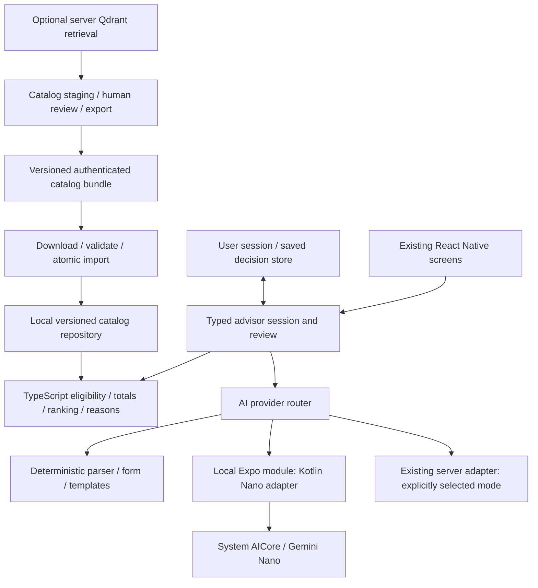

# Integrating the Android Device Advisor into Lựa

Research and implementation proposal · 12 November 2026

**Recommendation:** extend the existing Expo / React Native app with a shared TypeScript advisor core, a versioned local catalog and a small optional Kotlin bridge for Gemini Nano. Reuse the working picker, comparison, offers, persistence safeguards and AI validation. Prove the Nano toolchain and Vietnamese extraction on physical hardware before making Nano a release dependency.

This document adapts `Android_Device_Advisor_Integration_Plan (8).md` to the repository at commit `828c5f8` (`agent-a/api`). It is research and a proposed delivery plan. No advisor implementation, native SDK upgrade, model download or product-scope change was performed by this task.

## 1. Inputs, authority and evidence

| Input | What it establishes | Limitation |
|---|---|---|
| [Active root BRD](../../brd.md), v3.2 | Android-only React Native, Expo iteration, Material 3 Expressive, hackathon priorities, business safeguards | Draft requirements and stage acceptance remain distinct |
| [Implementation plan](./IMPLEMENTATION_PLAN.md), v3.2 | D0/D1/G0–G4 delivery framework, existing picker contract and native evidence requirements | Contains explicitly historical progress notes; use its current header and verification record for status |
| [Android source](../../apps/adviser/src/AndroidApp.tsx), [picker](../../apps/adviser/src/picker.ts), [domain](../../apps/adviser/src/domain.ts), [AI contracts](../../apps/adviser/src/ai.ts) | What is actually implemented and where extension is needed | Synthetic laptop logic, not production recommendation validation |
| [Android verification record](../../apps/adviser/VERIFICATION.md) | Previously recorded release APK/emulator, persistence, interaction and accessibility observations | Physical-phone, live-provider and full accessibility/performance acceptance remain open; those device observations were not repeated in this task |
| [Package manifest](../../apps/adviser/package.json), [Expo config](../../apps/adviser/app.json) | Current framework/dependencies and optional-server AI configuration | Compatibility with new native dependencies has not been compiled |
| Supplied integration attachment, v1.0 | Offline core, three device groups, typed patches, catalog synchronization, optional Nano, later LiteRT-LM and delivery contracts | Written without this host repository; Kotlin/Compose/Room assumptions need adaptation |
| [Crawler](../../crawler/README.md), [normalized records](../../data/all_laptops_normalized.json), [embedder](../../embedder/README.md) | Separate collection and Qdrant ingestion tooling exists | Not a reviewed catalog or a live app integration; service health was not checked |

Attachment reviewed at: `C:\Users\luken\.t3\userdata\attachments\6023434e-72a0-4118-a413-ba9bfff8340f-97d4c642-cc51-4d9a-a219-632050b87d52-md.md`. The earlier specification and original diagram linked inside it were not supplied as independent local files and were not independently inspected. Taxonomy and tier details here are attributed to this attachment rather than a fresh reading of the diagram.

The lowercase root BRD explicitly supersedes the historical uppercase planning BRD and its U19 additions. Keep that distinction. The new attachment is an integration input with material scope differences; importing it does not silently approve every difference or overwrite the existing baseline.

**Checks repeated during this research:** `npm run check` passed; `npm test` passed all 18 existing app tests; `npm run test:service` passed its one HTTP test using a controlled provider. These establish the current test baseline. They do not test Nano, SQLite, catalog synchronization, Phone/Tablet support or a live AI provider.

## 2. What can be reused, and what remains missing

| Capability | Current implementation/evidence | Integration action |
|---|---|---|
| Guest discovery and direct search | Working React Native screen flow | Keep search accessible without mandatory intake |
| Ordered needs intake | `Needs`, `validateNeeds`, `updateTasks`; 1–3 ordered primary uses, separate mandatory tasks, at most two soft preferences | Add versioned category/question configuration; retain the active cardinality policy until deliberately changed |
| Confirm before recommendation | Draft/review/confirmed needs; revision tracking | Generalize to field-level origins and typed edit operations |
| Local eligibility and costs | Integer VND, mandatory checks, unknown VM, inactive offers, conditional discounts, missing shipping | Generalize beyond fixture fields and represent complete purchase candidates |
| Ranking and result states | Deterministic ordering; `needsClarification`, no-fit and filter-empty behavior | Preserve those states; introduce reviewed utilities and missing-evidence treatment |
| Exact detail and paired comparison | Exact synthetic product IDs and offer relationships | Keep identity through category changes, snapshots and new catalog versions |
| Saving/recovery | AsyncStorage v2 envelope, legacy migration, corrupt-record isolation, dated saved observations | Preserve recovery behavior; add draft-session durability and transactional catalog storage |
| AI guardrails | Allowlisted needs proposals, fact-bound claims, revision rejection, timeout and deterministic fallback | Put provider adapters behind one interface; keep validation shared across cloud/local |
| Android UI | Custom React Native Expressive styling and adaptive components | Extend these components; Nano integration does not require Compose screens |
| Phone/Tablet/desktop support | Not represented by the current laptop-specific domain and fixtures | New taxonomy, rules, evidence, UI and data work; stage separately |
| Nano / LiteRT-LM | Not installed or bridged | Native feasibility and quality gates required |
| Reviewed offline catalog and sync | Static synthetic arrays; separate crawler files | Build staging/review/publication/export/import pipeline |
| Production readiness | Explicitly incomplete | Keep G1/G2/G3/G4 decision evidence and production requirements visible |

Important code constraints:

- `domain.ts` exports `PRODUCTS`, `OFFERS`, `TASKS` and `PRIORITIES` as global fixture arrays. `picker.ts` and `ai.ts` import them directly. Adding a repository interface without removing these dependencies would leave parts of the app evaluating different datasets.
- `Product` contains laptop-oriented `ram`, `ssd`, `weight`, `level` and `upgrade` fields. `level` and the ranking `QUALITY` values are illustrative assumptions. Do not map a real CPU name or battery capacity into these synthetic quality levels.
- `validOffers()` accepts exactly the 18 known fixture offers and identities. It is appropriate for the current workshop; it cannot validate a downloadable production catalog.
- `Store.version` is currently `2`, and the screen owns much of the persistence/session behavior. Introduce the next migration deliberately; the attachment's example `schemaVersion: 1` is a different contract and must not reset the app's storage version.
- The current `NeedsPatch` requires complete lists, budget and VM fields. The attachment's selective patch semantics need a new versioned contract, rather than treating an omitted field as a replacement or deletion.
- `AndroidApp.tsx` already uses request and revision refs to ignore late AI results. Extend that behavior to catalog, rules and session identity, including during save/restore and background transitions.

## 3. Resolve scope differences explicitly

| Topic | Active app/BRD | Supplied attachment | Recommended treatment |
|---|---|---|---|
| Host UI | Expo SDK 54 / React Native 0.81.5 / TypeScript | Kotlin native host, Compose preferred | Translate logical modules to TypeScript; native code only for platform capabilities |
| Device rollout | New laptops first, phones then PC builds when ready | Phone, Tablet and PC in first complete integration | Make architecture category-ready immediately. Deliver laptop integration first; track all three categories as a separate expanded milestone if adopting the full attachment |
| Number of purposes | 1–3 ordered uses | Exactly three ordered purposes | Configuration policy with different versions; do not force extra purposes onto existing users or migrated profiles |
| Number of priorities | Up to two soft preferences | Exactly three ranked priorities | Keep current policy in baseline; expanded flow needs its own review, migration and evaluation |
| Price input | Exact confirmed total ceiling | Preferred tier, target and separate hard ceiling | Add optional tiers/target; retain exact ceiling and clarify unknown ceilings |
| Initial AI | Optional bounded server adapter | Nano conditionally available, no silent cloud fallback | Add selectable local path and an explicitly selected cloud mode; local failure returns to form/templates |
| Data store | AsyncStorage + bundled fixture arrays | Room catalog/user databases | Prefer Expo SQLite behind repository boundaries; keep catalog/user ownership separate |
| Admin | Local fixture workshop for demo | Reviewed snapshots, rollback and operational control | Extend A02/A03/A04/A06/A07 outcomes through reviewed files/tools before a full portal |
| PC meaning | Laptops first; U13 reviewed PC builds later | PC subtype may include laptop/desktop | Separate laptop, prebuilt desktop and component build support. Category selection alone does not implement U13 compatibility |
| Scope duration | Demo first; hackathon priorities govern inclusion | Multi-week full integration | Treat offline AI/catalog work as a later increment with its own estimate; it is not a 4–6 hour scope |

The research recommendation preserves the current BRD as the working baseline. If the attachment is intended to supersede cardinality and category rollout, record a BRD/plan/traceability revision for those differences. Until that decision, implement reusable contracts and the bounded laptop slice; leave the alternate policy as a proposal.

Keep `Strength` as the attachment's stable concept with `UNRATED` status until a rubric exists. Do not rename it to storage or infer quality from brand. Treat personas such as Student/Elderly as prompts for clarification, not automatic hardware requirements. Preserve applicability: desktop battery is `NOT_APPLICABLE`, rather than a zero score.

## 4. Recommended integration architecture



The TypeScript domain owns all product eligibility, money, ranking and reasons. Kotlin owns SDK access, availability, download events and inference lifecycle. React Native owns presentation and review. A provider never writes the catalog, commits a confirmed need or opens a URL.

Suggested logical layout, introduced only as the corresponding work lands:

```text
apps/adviser/
  src/advisor/
    contracts/       # profile, patches, capabilities, run and reason contracts
    domain/          # eligibility, money, questions, ranking, applicability
    data/            # fixture adapter, SQLite adapter, snapshot import
    session/         # reducer, draft persistence, invalidation, review
    ai/              # deterministic, native and explicit-server adapters
    config/          # taxonomy, intake policies, questions, rubric versions
  modules/advisor-ai/
    android/         # Kotlin SDK boundary and lifecycle management
    src/             # typed JS interface and Android adapter
    index.web.ts     # unsupported capability; no native import in web preview
  plugins/           # reproducible Android build/config changes where needed
services/demo-ai/    # existing bounded server adapter retained
tools/catalog/      # proposed review, validation and snapshot-export tools
```

Do not create a parallel Kotlin ranking engine or replace every screen. Extract one dependency at a time from `domain.ts`, `picker.ts`, `ai.ts` and the screen state, keeping the existing tests as a regression baseline. Name `p1`–`p12` as fixture variant identities during migration; introduce separate family IDs rather than conflating a family with a purchasable configuration.

Expo documents local native modules as an integration path. This is a design fit, not evidence that the ML Kit/Expo combination already compiles. Native changes should live in the local module/configuration and survive Expo regeneration; hand edits under the ignored generated `android/` directory are not a durable integration. [Expo local modules](https://docs.expo.dev/modules/get-started/), [Continuous Native Generation](https://docs.expo.dev/workflow/continuous-native-generation/).

## 5. Nano feasibility: the first technical gate

### 5.1 Verified SDK findings and repository implications

| Finding checked in official sources | Consequence for this app |
|---|---|
| Prompt API requires Android API 26+ and exposes availability/download states | Current recorded build minimum is API 24; settle packaging/minimum OS before shipping Nano |
| ML Kit release notes list Prompt `1.0.0-beta5`, schema/compiler `1.0.0-alpha2`; this release's GenAI libraries require Kotlin 2.3+ | Installed RN version catalog declares Kotlin `2.1.20`; existing Expo integration must be compiled with an explicitly compatible toolchain |
| The getting-started sample still shows Prompt beta4; structured-output sample shows compiler alpha1 | Follow a tested, internally consistent dependency matrix, not a mix copied from samples |
| Structured output is Alpha, Kotlin-only, with a separate availability check and KSP setup | It is an optional adapter capability; schema-constrained generation still needs business validation |
| GenAI inference requires the top foreground app, with per-app/battery quotas | Do not call Nano from catalog background tasks; serialize calls and handle busy/quota/background outcomes |
| Model and language support vary by device | Availability does not establish Vietnamese extraction quality; record base model/device and evaluate |
| Custom native integrations need an app-specific build | Keep Expo Go for the pure-JS/form path; test Nano in development/release builds |

Sources: [Prompt setup and feature status](https://developers.google.com/ml-kit/genai/prompt/android/get-started), [ML Kit release notes](https://developers.google.com/ml-kit/release-notes), [Structured output](https://developers.google.com/ml-kit/genai/prompt/android/structured-output), [GenAI support and execution limits](https://developers.google.com/ml-kit/genai), [Expo development builds](https://docs.expo.dev/develop/development-builds/introduction/).

An additional local warning: the installed Expo autolinking plugin's `KSPLookup.kt` has mappings through Kotlin 2.2.20, but none for 2.3. Its root plugin throws when it must derive an unknown KSP version. An explicit compatible KSP setting may address that lookup, but does not prove compatibility across Expo modules, Compose compiler integration and the React Native Gradle plugin. Inspect the resolved Gradle versions in the spike; the RN catalog declaration alone is not a captured resolved build matrix.

### 5.2 Minimum OS and dependency decision

Recommended spike: use an internal Nano-enabled build with minimum API 26, leaving the currently supported core build unchanged while compatibility is evaluated. Before any production release, choose one of these supported arrangements:

1. Adopt API 26+ for the app after documenting the audience/support impact.
2. Maintain a core build without the Nano dependency for older Android versions and a tested Nano-enabled build for API 26+. This adds packaging and release maintenance work.

A JavaScript `SDK_INT` check cannot by itself solve a manifest minimum-SDK conflict. Android documents higher library minimums as a manifest merge issue. Avoid treating `tools:overrideLibrary` as proof of runtime safety. [Android manifest merge rules](https://developer.android.com/build/manage-manifests).

For Kotlin, first assess whether a bounded override plus explicit compatible KSP works in SDK 54. If it fails, estimate a separate supported Expo/RN upgrade, or leave Nano disabled and finish the core. Do not patch `node_modules`, suppress Kotlin metadata checks or assume moving Kotlin code to a local module isolates a host-wide dependency conflict. An older SDK version is only an alternative after its support, API contract and device behavior are independently checked.

### 5.3 Spike deliverables

- Pin and record Expo/RN/AGP/Gradle/JDK/Kotlin/KSP/Prompt/schema versions; record SDK minimum and merged manifest.
- Compile both development and release configurations, including release shrinking rules where enabled; verify native libraries/ABIs and relevant 16 KB page-size compatibility.
- In a supported physical phone, check capability, model version, download lifecycle and a bounded Vietnamese request. The existing x86-64 emulator is useful for unsupported/fallback testing; it is not Nano acceptance evidence.
- Exercise unavailable, not-yet-downloaded, interrupted download, busy, quota, background, timeout, cancel and late-response paths. Recheck after download instead of equating download completion with quality readiness.
- Run a small independently labelled smoke set covering negation, amounts and corrections. Record latency and rejection/fallback; use it to decide whether to proceed to the larger evaluation.
- Produce a go/no-go record. A failure leaves local form/rules usable and schedules any toolchain upgrade as explicit work.

## 6. Provider contract and user-visible behavior

Add one app-owned contract with capabilities independent of any SDK enum. The following is a design sketch, not compiled application code:

```ts
type AiMode = 'form' | 'nano' | 'server';
type RunContext = {
  sessionId: string;
  requestId: string;
  baseRevision: number;
  catalogVersion: string;
  ruleVersion: string;
  promptVersion: string;
  schemaVersion: number;
};
type ProposedEdit =
  | { field: 'budget.hardMaxTotalVnd'; op: 'SET'; value: number; evidenceText: string }
  | { field: 'budget.hardMaxTotalVnd'; op: 'CLEAR'; evidenceText: string }
  | { field: 'primaryUseOrder'; op: 'SET'; value: string[]; evidenceText: string };
// Extend this discriminated allowlist for approved fields; no arbitrary path/value API.
interface AdvisorAi {
  capability(): Promise<AiCapability>;
  extract(input: ExtractionInput): Promise<ProposedPatch>;
  organizeReasons(input: CheckedReasons): Promise<ReasonPlan>;
  cancel(requestId: string): Promise<void>;
}
```

`AiCapability`, inputs and outcomes need complete app-owned definitions in implementation. Include readiness/download state, structured-output support, task/language evaluation status and backend/model identifiers. Use `requireOptionalNativeModule` or an equivalent optional-loading boundary so Expo Go and the HTML preview can report unsupported without crashing on import. Match its API to the installed Expo version during the spike.

Routing policy:

- Every user can finish the form and use templates without AI/network.
- Local mode uses Nano only when availability, foreground state and the task's evaluation gate permit it; otherwise return to form/parser/templates.
- Server mode uses the existing bounded service only after a user-selected mode and explicit send. An offline/local failure must not trigger a cloud request.
- Do not call extraction on every keystroke. One in-flight native request per session is sufficient initially.
- An extraction proposes edits. The shared TypeScript validator checks schema, category, enum, money, negation/evidence and current context; the user reviews consequential changes before commit.
- Omitted field means unchanged. `CLEAR` requires an explicit request; clearing a required ceiling produces clarification, not unlimited budget.
- Enforce timeout, cancellation and a completion terminal state in both native and JS layers. On background/close, cancel where supported and invalidate the ticket regardless of whether native computation stops immediately.
- Persist only committed user answers/draft fields, not incomplete streamed model output. Do not resume inference automatically after process death.

The existing `renderClaims()` pattern is useful: the model selects allowed facts/reasons, and the app renders numbers and verdicts. Make those allowlists snapshot-specific. A valid fact ID with an invalid assertion must still fail; keep the existing contradictory-claim test. Free-form generated explanations need a separate factuality evaluation.

For Vietnamese money, distinguish “tầm 20 triệu” (target; clarify ceiling) from “không quá 20 triệu” (proposed ceiling). Compare model amounts with an independent deterministic parser when units are explicit. Never fill missing purposes merely to satisfy a three-item policy.

## 7. Data, storage and synchronization

### 7.1 Reuse collection tooling through a review boundary

The checked local normalized file has **70 product records across four source labels**. These are crawler records, not 70 confirmed unique purchasable variants or reviewed offers. Product fields include text specifications, retailer URLs, crawl timestamps and nullable facts. The current app still uses its 12 fictional configurations and 18 offers.

Proposed pipeline:

```text
existing crawler JSON
  -> staging validation and unit normalization
  -> exact manufacturer/region/configuration identity resolution
  -> separate Variant / Offer / PriceObservation / Evidence / Source records
  -> review data rights, conflicts, totals and publication status
  -> approved immutable snapshot + compatible policy versions
  -> authenticated manifest and bundle
  -> local transactional import
  -> same TypeScript eligibility/ranking/reasons as fixtures
```

Specific gaps before publishing these records: trustworthy part-number matching across retailers; per-fact provenance; explicit currency/units; shipping and mandatory charges; conditional discount eligibility; stock/freshness evidence; source reuse status; reviewed workload mappings. A missing shipping field stays unknown. Do not infer measured battery life from Wh, gaming performance from GPU name or repairability from a retailer label.

Retain raw records for review within the permitted retention scope. Publication should include only allowed evidence and assets. Keep synthetic/demo datasets visibly and technically separate. Fixture IDs must never resolve accidentally to a real seller URL.

`embedder/embeddings.py` defaults to n-gram feature hashing, not a trained multilingual semantic model. That can support a retrieval experiment, but it does not establish Vietnamese intent understanding. Existing Qdrant ingestion deduplicates source records; it is not a verified cross-retailer exact-variant resolver. No live Qdrant search or ingestion was run in this research.

Use Qdrant later for candidate/evidence discovery if measured retrieval quality warrants it. Its filtering supports payload constraints, but this app should revalidate retrieved IDs and revisions against the authoritative approved catalog before producing advice. The phone's core does not depend on remote Qdrant. A future server database can own publication state; PostgreSQL is not required to unblock the offline slice. [Qdrant filtering](https://qdrant.tech/documentation/search/filtering/).

### 7.2 Local storage choice

Use **Expo SQLite** as the first production-catalog candidate because TypeScript already owns the application domain. It provides persistent SQLite access without introducing Room entity mapping and a second catalog owner. This is a repository-specific recommendation, not a claim that it is universally faster than Room. [Expo SQLite](https://docs.expo.dev/versions/latest/sdk/sqlite/).

Keep AsyncStorage for existing settings/saved decisions during the first integration slice. Move user sessions to a separate SQLite store only when the transactional/session requirements justify it. Do not combine a schema migration, native AI upgrade and category expansion in the same change.

Minimum catalog tables: family, variant, offer, price observation, fact, source, taxonomy, question config, rule policy and catalog state. Use `(catalogVersion, variantId)` relationships and version-scoped queries. User-owned sessions/saved decisions retain schema version, confirmed profile revision and dated observations separately from replaceable catalog data. Money remains safe integer VND within validated application bounds; use explicit strings/checked conversion if crossing a Kotlin Long/JavaScript number boundary beyond those bounds.

Build first-start offline availability from a bundled reviewed snapshot. Import once through the same validator used for downloads; do not make the first launch wait for a network catalog request. Android's offline-first guidance supports immediate local reads and a local source of truth for app consumption. [Offline-first data layer](https://developer.android.com/topic/architecture/data-layer/offline-first).

The current versioned Expo SQLite documentation URL redirected to latest during research. Install versions compatible with the app's SDK using Expo's installer, inspect the locked package API, and compile. Do not copy the latest reference's recommended package number into the SDK 54 app.

### 7.3 Snapshot synchronization

The attachment's `/advisor/v1/manifest`, `/catalogs/{version}/bundle` and `/policies/{version}` are proposed endpoints; the current service exposes demo AI endpoints, not these catalog endpoints.

1. Obtain an authenticated manifest with schema/taxonomy/rule compatibility, catalog version, market, size, generated time and digest/signature metadata.
2. Download to bounded temporary storage; validate authenticity, digest, schema, units, references, publication mode and supported policy operators.
3. Import a new version within a transaction. Switch `activeVersion` only after complete validation; retain the previous usable snapshot.
4. Capture one immutable catalog/rule version for each recommendation run. An update invalidates derived results and explanation caches, with a visible refresh decision where needed.
5. On corruption, unknown schema, disk exhaustion or interruption, keep the old active snapshot and all user data. Garbage-collect snapshots only when no active run needs them; saved decisions retain dated context even if a product is later withdrawn.

Start with user-triggered/foreground refresh. Add `expo-background-task` if unattended refresh is justified; it uses Android WorkManager and is deferrable, so it cannot promise exact freshness times. Install an SDK-compatible version. Never run Nano in that worker. [Expo BackgroundTask](https://docs.expo.dev/versions/latest/sdk/background-task/).

Separate configuration suitability from current purchasability. An expired or incomplete price can be shown as historical/reference information; it cannot establish an affordable in-stock purchase today. Reopening a saved decision preserves its old timestamp. Clearing downloaded catalog data, deleting one saved decision and deleting personal history have separate scopes. Review Android backup behavior before promising data remains exclusively on the physical device.

## 8. Domain and journey extension

### Complete customer journey

Explorer/direct search or “Find a suitable device” → category/intake policy → relevant purposes and workload clarification → preferred price/confirmed ceiling → applicable soft priorities → review changed/unknown fields → locally evaluated results → exact detail/paired comparison → buying options or save/share.

Reuse existing screen destinations; place category and adaptive questions within the picker rather than adding a second advisor app. A user editing a confirmed need sees recalculation without losing independent preferences. Clearing result filters keeps the confirmed profile. A no-fit state identifies constraints and offers user-selected compromises without silently relaxing them.

Use a category registry to supply purpose definitions, applicable priorities, question predicates, supported facts, comparison rows and rules. Keep category-specific fields in discriminated types; a single bag of nullable laptop fields will obscure unsupported capabilities. Advertise only categories whose data/rules are ready. Do not show a tappable Phone/Tablet destination backed by laptop fixtures.

Each recommendation evaluates a `PurchaseCandidate`: exact variant + offer + required accessories/upgrades. All hard constraints must pass. Unknown critical evidence goes to clarification or a separately labelled needs-verification group. A score cannot compensate for a failed OS, application, accessory or total-cost requirement.

Preserve the existing ranking as the demo-policy baseline while extracting it. The attachment's 0.5/0.3/0.2 and 0.6/0.4 coefficients are proposed parameters, not validated improvements. Introduce a new scoring version only with reviewed pairwise examples. Do not mix battery protocols or infer a brand-quality rubric. Missing-preference evidence is unknown; overlapping score intervals do not establish a definitive winner. Results may contain fewer than three qualifying variants.

Store a run key covering session/profile revision, catalog, taxonomy/questions, eligibility policy and scoring versions. Explanation keys additionally cover locale, backend/model, prompt/schema and user question where relevant. Existing stale-response protection needs all these dependencies when the catalog becomes replaceable.

### Complete admin journey

For A02/A03/A04, an editor imports collected records, sees identity/cost/evidence problems, corrects or quarantines them, previews the resulting catalog and publishes a reviewed snapshot with an attributable revision. For A06/A07, a reviewer changes questions/rules, replays fixed cases, inspects changed exclusions/order, then activates or rolls back the compatible policy. For A09, operations sees degraded AI/sync status, keeps the usable snapshot/core active and disables only the affected capability. Initial tooling can be reviewed files and CLI reports; production authorization/audit requirements still apply before a real pilot.

## 9. Delivery packages and traceability

All packages below are proposed. Effort is incremental focused developer-days for an engineer familiar with this codebase, excludes data licensing/editorial effort, and assumes access to test hardware. Dependencies, quality failures and a framework upgrade can extend elapsed time. Do not add these estimates to the attachment's schedule as if they were independent.

| Package | Work and concrete output | Depends on | Maps to current scope / attachment | Initial effort |
|---|---|---|---|---|
| LUA-INT-01 | Record baseline, source conflicts, supported-category/intake policy and toolchain spike decision | — | PREP-01, DEMO-01/02; INT-01, CFG-01/02 | 1–2 days |
| LUA-INT-02 | Extract catalog/session/provider contracts; fixture adapter preserves current outputs | 01 | DEMO-03/04/05; CORE-01, DATA-01, HOST-01 | 2–3 days |
| LUA-INT-03 | Versioned partial patches, field origins, draft restore and consistent run invalidation | 02 | U01/U07/U08, AC-U01-01–04; CORE-01, STATE-01, AI-04 | 2–3 days |
| LUA-INT-04 | Reviewed catalog schema, staging validator and bundled laptop snapshot | 02 + data reviewer | A02/A03/A04, BR-01/04/09/15; DATA-01/02, CORE-02 | 3–5 days |
| LUA-INT-05 | SQLite adapter, migration and atomic foreground import/rollback | 03/04 | T-D06/08, production data gate; SYNC-01, STATE-01 | 3–5 days |
| LUA-INT-06 | Local Expo Nano spike, pinned matrix, physical capability/download/inference report | 01; hardware | Native feasibility + T-D09 extension; AI-01 | 2–4 days |
| LUA-INT-07 | Native extraction adapter, router, review, cancel/quota/background/failure integration | 03/06 passed | DEMO-09/10, BR-07/12; AI-03/04, OPS-01 | 3–5 days |
| LUA-INT-08 | Vietnamese evaluation, release regression, device/accessibility and performance evidence | 05/07; labelled cases | T-D01–09, AC-UX01–05; AI-02, QA-01/02 | 4–6 days |
| LUA-INT-09 | Controlled rollout record, independent AI/catalog flags, rollback and gate decision | 08; responsible reviewers | G2/G3/G4 as applicable; OPS-01, REL-01 | 1–2 days |

The bounded laptop integration is roughly **21–35 developer-days** by these work-package assumptions, plus unresolved framework migration, data review, device access and acceptance turnaround. Re-estimate after INT-04/06 rather than promising a calendar date. UI/core work can progress while the feasibility result is pending; Nano integration depends on a successful result.

Expanded milestones have separate estimates after category/data assessment:

- **Phone and Tablet:** category taxonomy, persona clarification, real facts, accessory totals, applicable OS/form factors, comparison and category-specific quality evaluation. These are mandatory to claim completion of the attachment's full three-category milestone; a laptop-only increment is partial against it.
- **Desktop / PC builds:** separate prebuilt desktop selection from U13 component solving. Reviewed compatibility templates and complete basket pricing precede unrestricted builds.
- **ReasonPlan generation:** optional once template explanations and extraction are reliable; attachment AI-05.
- **LiteRT-LM:** a later experiment for unsupported-Nano devices, covering model artifact/license, download integrity, cancellation, memory, accelerator and thermal cost. Its Kotlin runtime supports local model files and requires careful engine lifecycle; runtime availability is not device/model-quality evidence. Keep it out of the initial dependency path. [LiteRT-LM Android](https://developers.google.com/edge/litert-lm/android).

Correspondence for remaining attachment packages: CORE-03 belongs to reviewed scoring after domain extraction; UX-01/02 map to current picker/results plus the category expansion; HOST-01 maps to existing detail/offer/save actions; LOCAL-01/02 remain the optional runtime experiment. This preserves parent journeys rather than inventing new user/admin requirements for every SDK capability.

Do not change the existing traceability feature/acceptance statuses to “done” from this research. Add these package links and any new criteria when the corresponding scope revision/implementation is actually made. D1 currently expects a real server-provider interaction: a successful local Nano call is distinct evidence and does not silently satisfy or redefine G3. Record an explicit gate change if on-device AI is chosen to replace that D1 requirement.

## 10. Verification and completion conditions

Retain the 18 app tests and controlled service test as the regression baseline. Add checks when the corresponding behavior is implemented:

| Area | Required evidence | Attachment acceptance mapping |
|---|---|---|
| Eligibility/money | One-dong boundaries, missing required accessory cost, unknown OS/app, conditional discounts, no score overriding a hard failure | AT-03/04/05/07/14 |
| Category intake | Correct policy cardinality, independent draft fields, category-dependent invalidation, persona clarification, unknown/unrated/not-applicable | AT-02/06; AT-01 across all categories only at expanded milestone |
| State/races | Change ceiling, session, catalog and rules during inference; old outputs cannot overwrite; cancel/Back/background has a terminal state | AT-08/09 |
| AI contract | Wrong field/type/rank, unsupported category, ambiguous amounts, negation, malicious source text, valid-ID contradictory claims | AT-08/10 |
| Local catalog | First install offline, exact variant joins, imported policy compatibility, mixed-version rejection | AT-01/11 |
| Sync | Wrong signature/hash/schema, interrupted import, full disk, rejected activation, previous-snapshot rollback | AT-12 |
| User storage | Existing v1/v2 recovery, next schema migration, partial corrupt records, draft process death, deleted-history scopes | AT-13 |
| Runtime/build | Physical ready/downloadable/unsupported configurations; release packaging, lifecycle, model version changes | AT-09/15 |
| UI | Paired comparison, direct search without intake, large text, TalkBack, Back/IME, adaptive windows and reduced motion | Current AC-UX01–05 / T-D07 |

Start the language spike with a small labelled set, then use a separated development/validation/held-out evaluation. The attachment proposes 500 situations (300/100/100); those data do not exist merely because the number is specified. Cover Vietnamese accents/no accents, units, corrections, code switching and critical negation. Report raw accuracy, accepted accuracy, coverage and abstention by task/category/model. An always-fallback model does not pass a useful extraction gate.

The attachment's 99% explicit-money exact match, F1 0.95, 80% pairwise agreement, 200 ms local p95 and 5 s warm extraction p95 are provisional targets. Ratify sample sizes/baseline devices and report uncertainty and critical errors; a small test set cannot substantiate a broad 99% reliability claim. Cold/warm timings and app-process/AICore resource observations must be separated. Record unobservable accelerator/service costs as limitations.

Completion of the bounded integration requires: a release app with offline laptop core; reviewed bundled data; safe migration/import/rollback; measured provider availability/fallback; user-confirmed extraction; no stale-result commits; representative physical/accessibility evidence; and a recorded decision against the applicable stage gate. Completion of the full attachment additionally requires Phone and Tablet journeys/data and the agreed PC scope. Neither a native dependency compiling nor this research constitutes integration completion.

## 11. First implementation slice

Implement **Explorer → existing laptop picker → confirmed profile → local reviewed snapshot → results/detail/compare/save**, with one optional action that proposes a Nano-derived needs edit on a validated physical device. When Nano is unavailable, the same journey completes through the form. With the network disabled, the catalog and rule/template path remain usable. A catalog update or budget edit invalidates old advice without losing the user's answers.

The first technical task is LUA-INT-01/06: make the Kotlin/KSP/minimum-OS and physical-device decision concrete. In the core, begin LUA-INT-02 by passing a fixture catalog explicitly into the evaluator and AI validator, preserving all current regression outcomes. That creates a useful, reviewable increment even if Nano or real-data readiness is delayed.
