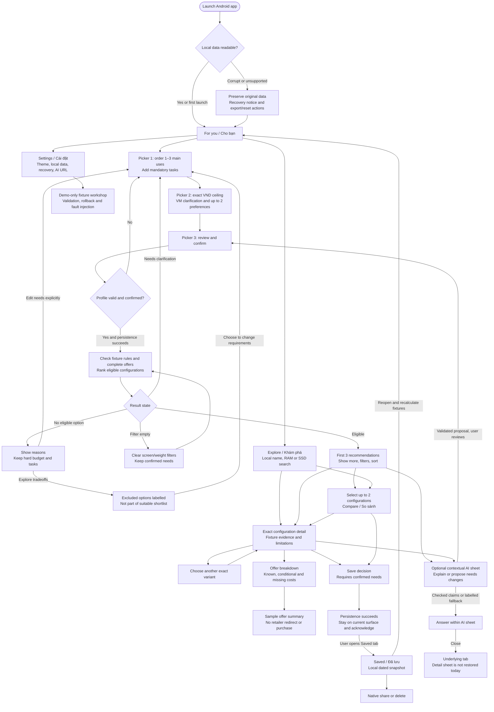
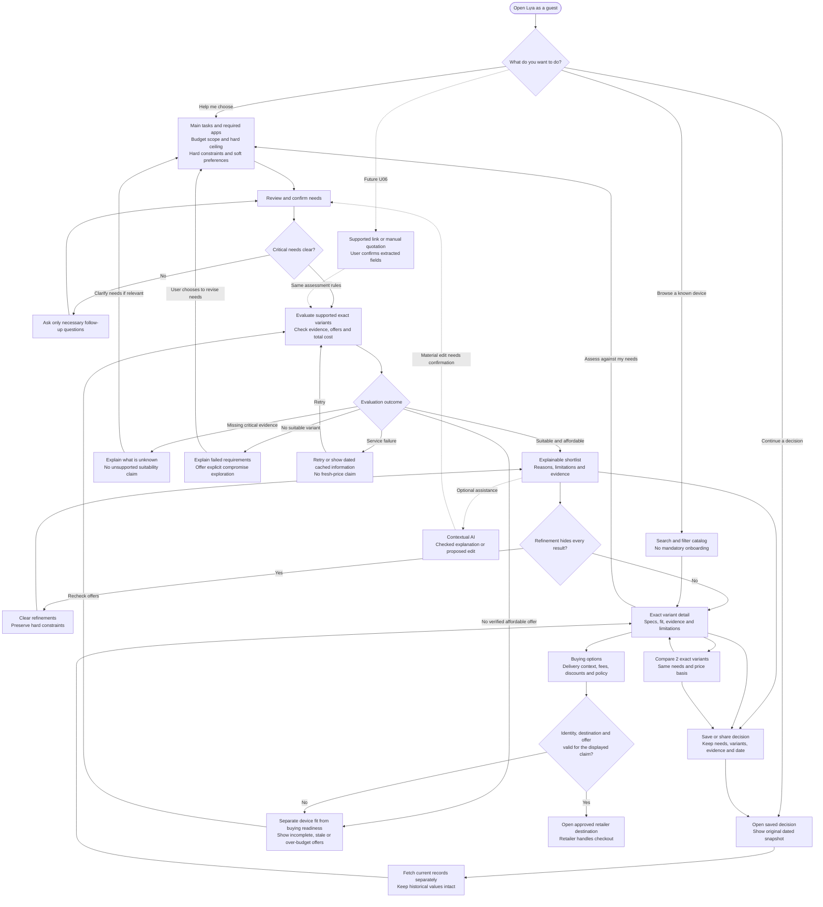
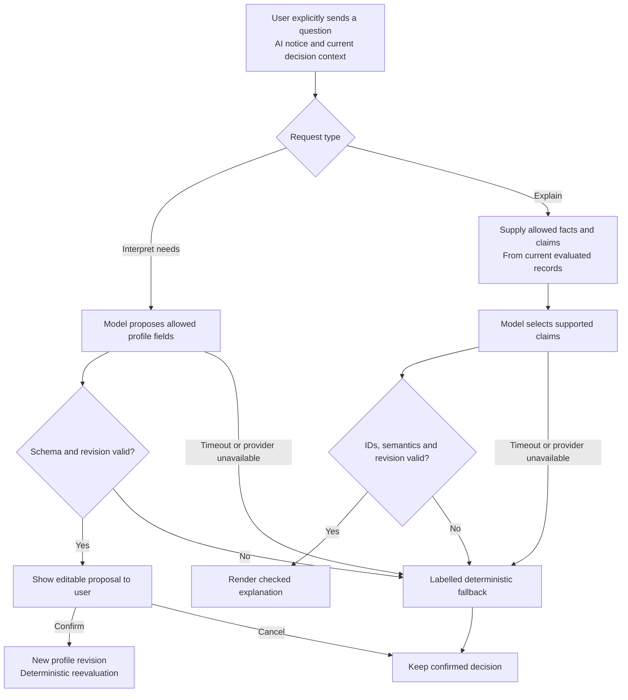
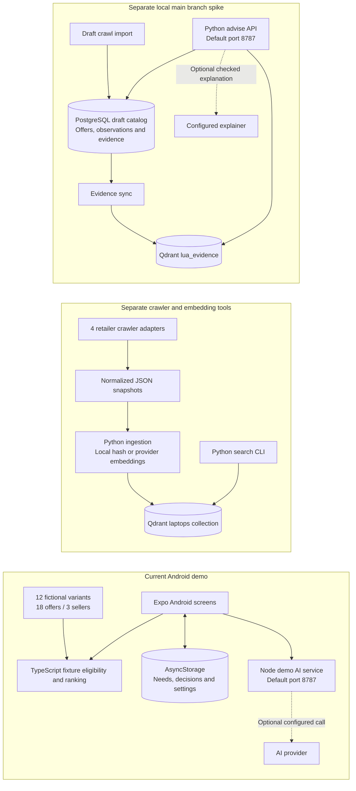
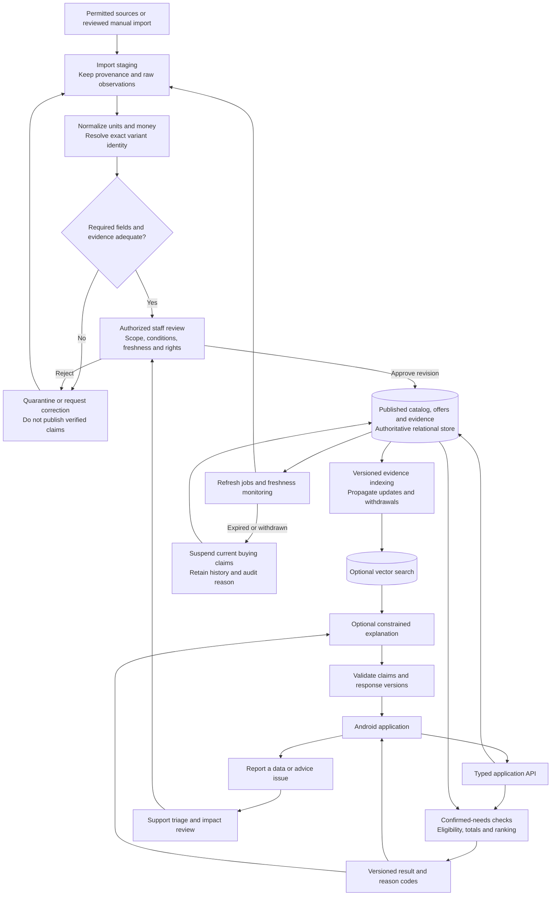

# Lựa app flow — current demo and proposed full application

Reviewed 13 November 2026 (Asia/Saigon), against `agent-a/api` at `d2f26ee`. Companion: [repository research](./REPOSITORY_RESEARCH_2026-11-13.md).

Deeper source review: [state ownership, 23 transitions, eight findings and regression contracts](./APP_FLOW_DEEP_RESEARCH.md). Six controlled probes reproduce current persistence/restore/explanation issues. The diagrams below summarize routes; they do not certify the reliability of every transition.

These diagrams distinguish inspected implementation from proposed production behavior. They do not change the requirements baseline or record stage-gate approval. The selected baseline is [root brd.md](../../brd.md), version 3.2: Android only, Expo/React Native, Vietnamese/VND, with HTML/CSS previews. Laptop-first production scope remains a proposal to confirm before implementation.

## 1. Current demo: the flow that exists

All products, prices, sellers and capability rules in this diagram are fictional. The current runtime is [AndroidApp.tsx](../../apps/adviser/src/AndroidApp.tsx), registered by [index.js](../../apps/adviser/index.js).

The five actual bottom tabs are **For you, Explore, Compare, Saved and Settings**. Picker, filters, detail, contextual AI and sample offers are sheets. A recovery notice does not establish successful recovery; blocked writes require the explicit recovery/reset action.

Current limitations: an initial storage read error does not block later writes; concurrent whole-store writes and delete/reset can lose or restore data unexpectedly. Corrupt-byte export also has a gap. The detailed review supplies source evidence and required fixes; recovery arrows describe intended user routes, not proven data safety. Android modal Back follows each sheet's handler; chat opened from detail currently closes to the tab beneath it.

`picker.ts:evaluate` returns `needsClarification`, `noEligible`, `filterEmpty` or `eligible`. `domain.ts:fit` currently combines workload, offer availability and budget failures into one eligibility result. Search is local substring matching, independent of the Python/Qdrant search.

## 2. Proposed full application: the buyer's decision flow

This is the proposed laptop-first production journey. The interaction path is reusable; audited data, current offer checks, server contracts and failure states still need implementation. **Dashed connections mark future scope or optional behavior; they do not mean implemented integration.**

Production rules for this flow:

- Browsing is useful before a profile exists. A suitability claim requires confirmed needs. A confirmed profile is required to save a *decision* in the demo; standalone bookmarking without a profile is a separate scope decision.
- New laptops are the proposed first category. Phones, used devices and PC builds need their own evidence and acceptance, even when they later reuse these screens.
- A low listing price is not a verified payable total. Unknown shipping stays unknown; unconfirmed coupons remain conditional; same-family variants remain distinct.
- No suitable variant, no verified affordable offer, refinement hides results, and service failure need different recovery actions.
- Editing a draft does not change the active confirmed decision. Confirmation creates a new profile revision and invalidates affected results. Ignore late responses from previous runs.
- Historical snapshots preserve their date and original identity. Removed or suspended variants do not silently become another device.
- The buying destination is a retailer handoff, not an order confirmation. Offer caveats remain visible; the app must not record a purchase from a click.
- U06 is urgency 3 in the active hackathon baseline, although the later production plan discusses U01–U08. This diagram exposes the dependency without silently adding quotation intake to the first production build.

## 3. Optional AI: a bounded branch of the decision

Current demo contracts implement much of this boundary with fictional records. Real evidence, production monitoring and a live-provider acceptance run remain future work.

AI cannot author an authoritative product identity, price, retailer URL or eligibility verdict. Matching a real evidence ID is insufficient when the claim contradicts that evidence. The demo service exposes `/demo/needs/interpret` and `/demo/advice/explain`; the separate `main` spike exposes `/api/advise` and is **not** a replacement URL for those contracts.

## 4. Existing components and their actual connections

These are separate implementations. No edge connects the crawler or Qdrant to the Android catalog today. The `main` group was inspected through Git, without merging or running it.

The two servers share default port 8787 and have incompatible endpoints. Reconcile contracts and deployment ownership before treating them as one backend. The Python spike's listing-price filter does not implement the full Android workload/total-cost policy.

## 5. Proposed production data and administration flow

This follows the BRD publication and correction lifecycle. PostgreSQL/Qdrant have prototype precedent, but production runtime/framework and deployment are still choices. Qdrant is a derived evidence index, not the authority for payable totals or eligibility.

Minimum staff capabilities: source/import review; exact-variant, offer and evidence editing; publication/suspension; rule/prompt evaluation and rollback; issue resolution; health/freshness monitoring; and access control. The local demo workshop does not satisfy production staff permissions or audit history.

## 6. Screen and state contract for the first production slice

| Surface | Responsibility | Important alternate states | Existing basis |
|---|---|---|---|
| For you / Explorer entry | Start needs or continue a decision | Guest, unconfirmed, restored history | Home and Search exist; consolidation is a design decision |
| Guided needs | Ordered uses, ceiling/scope, workload questions, preferences | Draft, invalid amount, unanswered critical need, cancel | Three-step picker; four fixture task types |
| Results | Versioned eligible shortlist and exclusions | Clarification, no fit, no offer, filter empty, service failure | Four-state fixture evaluator; production states need separation |
| Variant detail | Exact configuration, evidence and task verdicts | Missing/conflicting evidence, removed variant | Fixture detail and variant switching |
| Comparison | Two variants under one needs/price context | Empty/one selection, unsuitable option, incomparable price | Two-item comparison |
| Buying options | Accepted match, total, conditions, observed time | Partial total, conditional saving, stale/unavailable/suspended | Fictional breakdown; real refresh/redirect missing |
| Saved decisions | Original local snapshot and current reevaluation | Old schema, deleted variant, write failure, corrupt record | Versioned persistence and recovery |
| Settings and data | Theme, local data controls, service disclosure | Permission refused, recovery required | Local controls; separate workshop from consumer release |
| Contextual adviser | Explanation or needs proposal | Loading, invalid/stale response, timeout, fallback | Bounded client/server contracts |
| Staff operations | Review/publish/correct with scoped authority | Invalid import, conflict, denied access, rollback | Proposed; fixture editor is only a precursor |

## 7. Invariants for implementation and acceptance

1. Mandatory needs pass before ranking. Preference, vector similarity and AI cannot override budget or a failed task.
2. Carry exact variant identity through search, comparison, offers, saving and sharing.
3. Record decision ID, profile revision, catalog version, rules version and request/run identity. The demo has some version fields, not the complete production envelope.
4. Keep fit, offer validity and total completeness separate. Missing critical evidence is unknown.
5. Keep draft, confirmed and historical state separate. Outdated responses cannot replace active results.
6. Persist successfully before acknowledging a save; preserve recoverable old data on failure.
7. Keep browsing and deterministic decisions useful without AI. Source failure does not establish an empty catalog or a newly verified cached price.
8. Separate synthetic fixtures, crawled draft data and reviewed production records technically and visibly.

See the [research report](./REPOSITORY_RESEARCH_2026-11-13.md) for evidence, gaps and the proposed build sequence.
