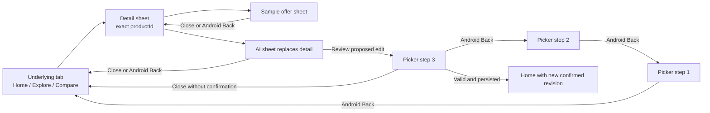
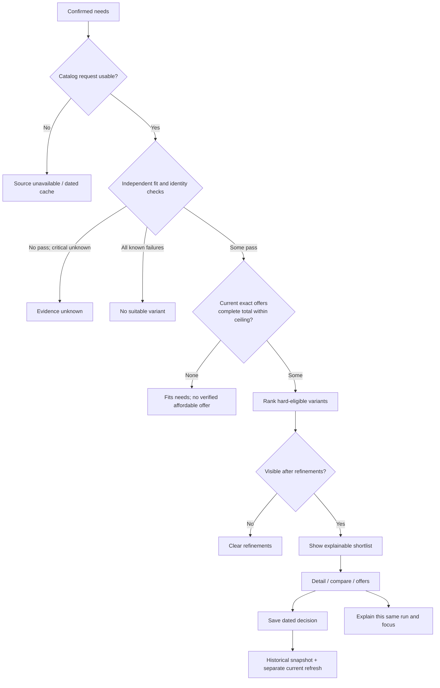

# Lựa app flow: source-level research and build contract

Reviewed 13 November 2026, `agent-a/api` at `d2f26ee62e50d661e30bc2aa271ae061f9e4e823`. Scope: current Android demo and the next production slice. Companion [overview diagrams](./APP_FLOW.md), [Codex plan](./PREBUILD_RESEARCH_PLAN.md), [unit-pack catalog](./PREBUILD_TEST_PACKS.json).

**Finding:** the demo already supports a complete fictional decision journey. Its main implementation risk is coordination between persisted state, transient navigation, result context and asynchronous actions. Adding real data without defining those boundaries would preserve data-loss and stale-answer paths.

This review inspected owning source, executed six reproducible source-behavior probes, and checked Android Back semantics against the installed React Native version's documentation. It did not run a new native walkthrough, interview buyers, call an AI provider, or repair the app. [Raw observations and source hashes](../../research/prebuild/flow-review/current-flow-observations.json) distinguish these checks from the R00–R14 research execution.

## 1. Runtime and state ownership

Both [Expo entry](../../apps/adviser/index.js) and [web preview entry](../../apps/adviser/src/main.web.tsx) load [AndroidApp.tsx](../../apps/adviser/src/AndroidApp.tsx). The older `src/App.tsx` is not the entry point for these surfaces.

The current navigation model is one component with a tab variable and one sheet variable; it is not a navigation stack.

| State owner | Current fields | Lifetime / consequence |
|---|---|---|
| Persisted `Store`, key `lua-android-v2` | needs, saved decisions, theme, all fixture offers, service URL | Whole-store writes; restored at launch. Old `lua-demo-v1` is migration input |
| Active needs | tasks, ordered uses, additional required tasks, budget, VM answer, preferences, confirmation, revision | Only accepted after validation and successful persistence |
| Picker draft | copied needs, budget text, step 0–2 | Cancel/close does not commit; another open copies the active needs again |
| Result derivation | `evaluate(needs, filters, offers)` | Synchronous in-memory calculation, not a catalog API request |
| Refinements | active and draft filters, expansion, tradeoff exploration | In memory; no change to hard needs; not restored after process death |
| Navigation | tab, sheet, productId, selected comparison IDs, sampleOffer | Five tabs; at most one sheet; comparison selection is not persisted independently |
| History context | selected saved snapshot | Reopening restores its needs and recalculates current fixture offers; the dated snapshot remains separate |
| AI | question, answer, patch, busy/mode, requestId, profile revision ref | Request ticket rejects late results; no offer/catalog revision guard |
| Storage coordination | promise queue, storageError, rawRecovery | Queue serializes writes, but currently receives already-built whole-store snapshots |

Source anchors: `AndroidApp.tsx:381–422`, `430–645`; `picker.ts:Needs/Store/Snapshot/restore`. Line numbers refer to the hashed source in the observations file.

## 2. Actual interaction contract

Rows describe inspected behavior, including restrictions. “Save” acknowledges persistence without automatically opening the Saved tab.

| ID | Entry → action → destination | Guard and state effect | Regression ownership |
|---|---|---|---|
| T01 | Launch → restore → Home | Valid store restores; empty storage uses defaults; read error still sets ready today | U06-10, U06-12 |
| T02 | Home → Start/edit → picker step 1 | Copy active needs; ordering has 1–3 uses; extra tasks stay mandatory | U06-01, U06-08 |
| T03 | Step 1 → Next → step 2 | Requires a main use; budget/VM/preferences are edited in draft | U06-01, U06-08 |
| T04 | Step 2 → Review → step 3 | Review is reachable while invalid; errors disable final confirmation | U06-02, U06-03 |
| T05 | Step 3 → Confirm → Home/results | Validate, persist, increment revision, clear filters/history/expansion, then dismiss | U06-02, U06-03, U06-14 |
| T06 | Picker Back / close | Android Back moves one picker step back; close dismisses the whole picker | U06-01, U06-13 + native D02 |
| T07 | Home/results → filters → apply/cancel | Draft filters commit only on Apply; clearing filters preserves needs | U06-04 |
| T08 | Results → Show more / tradeoffs | First three matches expand; at most four excluded fixture options appear separately | UBASE, U06-04 |
| T09 | Explore → type name/RAM/SSD → detail | Local substring search over 12 fixtures; no questionnaire required, no server/vector search | UBASE + native D01 |
| T10 | Product card/detail → compare toggle | Max two distinct IDs; third is rejected rather than replacing a selection | U06-05 |
| T11 | Compare → detail / remove / save | One or two selections are usable; ineligible options remain visibly ineligible | U06-05, U06-07 |
| T12 | Detail → switch configuration | Only fixture p1/p4 expose the sibling switch; every subsequent offer belongs to the chosen ID | U07-04, U08-03 |
| T13 | Detail → sample offer → detail | Only current offers open; incomplete total stays incomplete; no external destination or order | U07-03 + native D04 |
| T14 | Detail/Compare → save | Requires confirmation flag; snapshot includes needs, IDs, totals/seller/time and versions; acknowledge after write | U06-03, U06-07, U06-12, U06-14 |
| T15 | Saved → reopen → Home | Persist saved needs, restore at most two selected IDs, clear filters, keep history label; reuse saved revision | U06-07 |
| T16 | Saved → share/delete | Share dated fictional summary; delete rewrites saved list; errors preserve prior committed store | U06-03, U06-09, U06-11 |
| T17 | Settings → theme/service URL/fixture price | Whole-store persistence; offer changes trigger result recalculation, not AI invalidation | U06-09, U10-12 |
| T18 | Settings → export/recover/reset/delete all | Recovery/reset/deletion use separate direct storage operations today | U06-10, U06-11 |
| T19 | Results/detail → AI → explain | Sheet replaces the prior sheet; request carries text, needs, offers, but no focused variant IDs | U10-11, U10-14 |
| T20 | AI → proposed needs → review | Allowed patch fields become an unconfirmed draft at step 3; final confirmation uses T05 | U10-04, U10-10 |
| T21 | AI → cancel/background/dismiss | Ticket invalidates the response; underlying fetch is only aborted by its own timeout today | U06-06, U10-06, U10-13 |
| T22 | Detail → AI → close | Returns to underlying tab, not the detail sheet; prior productId survives but detail is not reopened | U06-13, U10-14 |
| T23 | Non-Home tab → Android Back | Returns to Home; Back at Home delegates to system; modal Back uses its own handler | U06-13 + native D02 |

### Navigation detail that the original overview obscured



The shared Sheet passes `onBack || onClose` to Modal's `onRequestClose`; its visible close control always calls `onClose`. Android does not emit global BackHandler events while a Modal is open, so reading only the global listener gives the wrong picker/sample flow. This interpretation follows [React Native 0.81 Modal](https://reactnative.dev/docs/0.81/modal#onrequestclose) and [BackHandler](https://reactnative.dev/docs/0.81/backhandler). Native keyboard/focus behavior still requires device observations.

## 3. Findings with reproducible evidence

Priority below is an engineering recommendation, not a newly accepted release gate. FLOW-01–06 were reproduced against original functions/closures with controlled dependencies. FLOW-07–08 are source findings; device frequency and usability impact remain unmeasured.

### FLOW-01

**Queued writes can lose an acknowledged change.** `persist(next)` serializes writes but `next` was composed from the caller's old `store`. Two successful operations from the same state—theme change, then save—end with the save retained and the theme reverted. The same pattern can lose a concurrent saved decision or settings change.

- Evidence: `AndroidApp.tsx:493–515,538,590,1212–1218`; probe FLOW-01 returned `[true,true]` while final `dark=false`.
- Fix contract: queue commands/updaters, reduce against latest committed state when dequeued, persist, then acknowledge. Keep one pending action identity for repeated taps.
- Owner/checks: R06; U06-09/U06-14. Resolve before relying on local decisions with real data.

### FLOW-02

**Failed initial reads do not prevent later writes; recovery export is incomplete.** A rejected `multiGet` records an error and sets ready; it leaves `rawRecovery` empty, which is the only ordinary write barrier. A later write is allowed without knowing whether old data exists. Separately, a parse failure retains the failing bytes in memory, but “export recovery” reads only the recovery key; that key is not populated by the parse-failure branch and may be absent or older.

- Evidence: `AndroidApp.tsx:430–455,493–497,1288–1292`; probe FLOW-02 reproduced ready + read error + allowed write. The export gap is source-traced, not a native-share observation.
- Fix contract: explicit boot state `loading|ready|read_failed|recovery_required`; only ready permits normal writes. Export current failing bytes where present; never substitute an unrelated backup silently. Retry and explicit reset remain separate actions.
- Owner/checks: R06; U06-10. Resolve before local-data reliability acceptance.

### FLOW-03

**Delete/reset can race with queued writes.** Delete-all bypasses the write queue. An already queued update can execute after deletion and restore the old decision. The probe exercised the actual delete handler and persistence closure with a controlled acknowledgement delay; injected storage operations remain ordered as write1 → delete → write2.

- Evidence: `AndroidApp.tsx:493–515,1255–1273,1302–1316`; probe FLOW-03 deleted storage, then observed `old-decision` reappear after the pending write completed.
- Fix contract: one coordinator for update/delete/reset, with storage generation invalidation and completion semantics. After delete acknowledgement, no prior-generation operation may restore data.
- Owner/checks: R06; U06-11. Reproduce both ordering directions and restart.

### FLOW-04

**Restore validates only part of a saved decision.** A snapshot with invalid date, missing dataset/policy version, negative observed total, non-string seller and an unrelated observation product ID was accepted without warning. A restored confirmed profile can also contain duplicate ordered uses and fail normal `validateNeeds`.

- Evidence: `picker.ts:validStoredNeeds/restore`; probe FLOW-04 records the exact synthetic input.
- Fix contract: one shared needs schema plus stricter confirmed-state validation; full snapshot schema and reference checks. Preserve corrupt input for export. Removed catalog identities need historical tombstones, not silent substitution or loss of history.
- Owner/checks: R06/R07; U06-12/U07-01/U07-04. Separate old unconfirmed migration records from invalid confirmed records.

### FLOW-05

**Fallback explanation and ranked results use different candidate orders.** For creative use with a 30,000,000 VND ceiling, the ranked first two are `p5,p12`; the fallback describes `p2,p4`. All are fixture candidates, but the explanation is not grounded in the displayed ranking or focused detail.

- Evidence: `ai.ts:localExplanation` filters PRODUCTS directly after calling evaluate; `picker.ts:rank/evaluate`; probe FLOW-05.
- Fix contract: explanation consumes the same evaluated run and explicit focus as the screen. Distinguish explaining a specific detail from explaining the ranked shortlist.
- Owner/checks: R10/R07; U10-11/U10-14. Resolve before contextual-AI journey acceptance.

### FLOW-06

**A late answer can use the old offer amount after prices change.** Start a workshop price update, open AI while its storage write is pending, then let the update commit before the answer arrives. The request ticket and profile revision remain valid. Original `ask` + original `explain`, with fetch replaced, accepted 18,900,000 VND after current data produced 19,100,000 VND for that same variant. This sequence does not require operating Settings behind an open modal.

- Evidence: `AndroidApp.tsx:601–637,1385–1396`; `ai.ts:explain`; probe FLOW-06. No live provider was called.
- Fix contract: include catalog/rules/offer context and run identity in response validity; invalidate affected requests on evidence changes. Apply the same rule to future retrieval/API results.
- Owner/checks: R07/R10; U07-06/U10-12. Resolve before asynchronous real-offer integration.

### FLOW-07

**“Contextual” AI loses focus and the detail return path.** `openChat` only clears answer/patch and sets the sheet. The request has no selected variant context, and closing chat sets the sheet to null. A detail-initiated question can therefore receive a general answer and return to the underlying tab.

- Evidence: `AndroidApp.tsx:641–645,2031,2061–2064`; `ai.ts:explain`; FLOW-06 also records payload keys.
- Proposed behavior: record origin + focused IDs; closing AI returns to the exact origin. Proposed needs edits still go through confirmation and deliberately return to refreshed Home.
- Owner/checks: R06/R10; U06-13/U10-14. Validate whether this navigation is understandable in buyer sessions.

### FLOW-08

**Cancel suppresses UI updates but does not propagate transport cancellation.** Close/cancel/background increments the request ticket; the client AbortController is private to `request` and aborts only on its eight-second timer. This is useful stale-response protection, but it does not prove the network/provider stopped or cost was avoided.

- Evidence: `AndroidApp.tsx:484–489,2061–2064,2097–2101`; `ai.ts:request`.
- Fix contract: caller-supplied AbortSignal and cleanup; record actual provider usage and distinguish stopped presentation from confirmed cancellation. No promise of refund or stopped provider work without evidence.
- Owner/checks: R10; U10-06/U10-13. Native lifecycle confirmation remains D06.

## 4. Production result-state decision table

These are proposed contracts for R07/R08. Today `fit` mixes task/offer/budget failure, while `evaluate` returns only needsClarification/noEligible/filterEmpty/eligible. Do not map every production failure to noEligible.

Apply the table in order to the requested supported scope; keep per-candidate reason codes alongside the summary.

| Condition | Summary state | User recovery / constraint |
|---|---|---|
| Essential needs missing or not confirmed | `needs_clarification` | Review only missing needs; browsing remains available |
| Current catalog/evaluation request failed | `source_unavailable` | Retry or explicitly dated cache; failure is not zero inventory |
| No known passing variant and critical capability/identity evidence is unknown | `evidence_unknown` | State evidence gap; do not invent compatibility or ask user to fix a source problem |
| Supported scope evaluated; all candidate workload/hard constraints fail, none unknown | `no_fit` | Show decisive failures; only explicit user edits change requirements |
| At least one fitting variant, no valid complete affordable offer | `no_verified_affordable_offer` | Show fit separately from unknown costs, expired offers and over-budget totals |
| Verified eligible set exists; UI refinements hide all | `filter_empty` | Clear refinements only; preserve confirmed needs |
| At least one visible verified eligible candidate | `eligible` | Ranked shortlist with evidence, limitations and current context |
| Response context no longer matches active run | Discard / `stale_revision` at API boundary | Preserve newer screen; do not flash stale results or overwrite drafts |

A partial unknown set can coexist with valid matches; report its coverage separately. Search with no name matches is a search empty state, not proof no device fits the person's needs. Saving a labelled unsuitable comparison is allowed as a decision record; saving is not an endorsement.



## 5. Proposed state and effect boundaries

Use these responsibilities in R06/R07; final file placement follows the existing TypeScript app. Avoid extracting a parallel model used only by tests.

| Boundary | Owns | Must not own |
|---|---|---|
| Decision transitions | draft, confirmation, action identity, active decision revision | Network or direct storage calls |
| Persistence coordinator | hydration status, ordered mutation commands, durable commit, reset/delete generation | UI suitability or AI claims |
| Catalog/offer repository | dataset mode, exact identity, observed revisions, cache/freshness and source failures | Confirmed personal needs |
| Deterministic evaluator | fit, offer validity, total completeness, affordability, ranking and reason codes | Provider-written facts |
| Navigation state | tab, sheet/origin, focused IDs, draft cancellation and back actions | Implicit confirmation of needs |
| AI adapter | immutable request context, allowed claims, cancellation, proposal/fallback | Direct mutation of confirmed needs or saved history |
| Historical snapshot | frozen identity/configuration, needs, evidence/price time and version | Automatic rewriting from today's catalog |

Minimum request context:
`{decisionId, runId, requestId, profileRevision, catalogVersion, rulesVersion, offerContextHash, focusVariantIds, origin}`.
Offer context includes destination, discount eligibility and charge basis. A profile revision alone is insufficient. Reopening a decision selects its identity and starts a new run; it does not make the historical price current.

```mermaid
sequenceDiagram
    participant UI as Picker / screen
    participant D as Decision transitions
    participant P as Persistence coordinator
    participant S as Local storage
    participant E as Evaluator / repository
    participant A as AI adapter
    UI->>D: Confirm draft with actionId
    D->>D: Validate; deduplicate pending action
    D->>P: Enqueue confirmed-needs command
    P->>P: Reduce against latest committed state
    P->>S: Write next store for current generation
    alt Write fails or generation invalidated
        S-->>P: Failure / superseded
        P-->>UI: Keep prior committed decision; actionable error
    else Durable success
        S-->>P: Written
        P-->>D: Commit new revision
        D->>E: Evaluate immutable run context
        E-->>UI: Context-matching result
        UI->>A: Explain result + focused variant IDs
        alt Context changed / cancel / background
            A-->>UI: Suppress stale answer; retain actual usage record
        else Context still current
            A-->>UI: Checked claims or same-context fallback
        end
    end
```

## 6. Native and buyer validation still required

Unit cases cover transitions and injected effects. They do not establish these device outcomes:

| ID | Device journey / independent evidence |
|---|---|
| D01 | Cold launch and full guest path: needs → results → exact detail → compare → sample offer → save → kill/relaunch → reopen |
| D02 | Hardware Back and close at every picker step, detail, sample and AI; correct origin and selection retention |
| D03 | Invalid budget, numeric keyboard, focus after error, max font size, portrait/landscape; essential controls remain reachable |
| D04 | Variant switching, offer breakdown and partial totals understood; no misleading retailer/order action in demo |
| D05 | TalkBack order, names and announcements; keyboard/focus isolation while sheets are open |
| D06 | Background/resume, rapid repeated actions and cancellation during storage/network delays |
| D07 | Corrupt store, failed read/write, reset/delete with pending work; restart verifies durable outcome |
| D08 | Historical price versus current refresh, removed variant and offline/source-failure messaging |

R06 buyer research must test understanding of draft versus confirmed needs, fit versus affordable purchase, AI proposal versus applied edit, and historical versus current price. Record real task outcomes and misunderstandings; these source probes are not participant observations.

## 7. Execute the next research work

1. R06: extract the smallest production-used transition/persistence helpers; add failing regressions U06-09–14 before fixes. Record intended navigation T19–T23.
2. R07: implement the separated outcome and request-context schemas; resolve the current Node/Python endpoint mismatch before connecting a catalog.
3. R08: exercise one vertical slice with independent expected totals, exact variants, history, concurrent persistence and evidence withdrawal.
4. R10: bind AI/fallback to the same result/focus; cover offer revision changes and cancellation with U10-11–14.
5. R11: run D01–D08 on a named build/device and record inaccessible checks honestly.

Reproduce the current-source findings from the repo root:

~~~powershell
node --experimental-strip-types research/prebuild/flow-review/probe_current_flow.mjs
~~~

Requires the app's installed, pinned TypeScript package. The script runs six diagnostics with assertions, writes source hashes, and never mounts React, accesses user storage or sends network calls. **Successful diagnostic assertions mean the current issues were reproduced.** When fixing them, archive this report and replace the relevant reproduction expectations with desired-behavior regressions; do not preserve a bug just to keep a diagnostic green.

Review checks on 13 November: 18 existing application unit tests passed; 10 new plan-contract unit tests passed; all six source diagnostics reproduced their recorded observations. Local document links, case references and observation-source hashes were checked. These results do not establish corrected application behavior, native accessibility/lifecycle behavior or live AI acceptance. Application source was not changed by this research pass.
