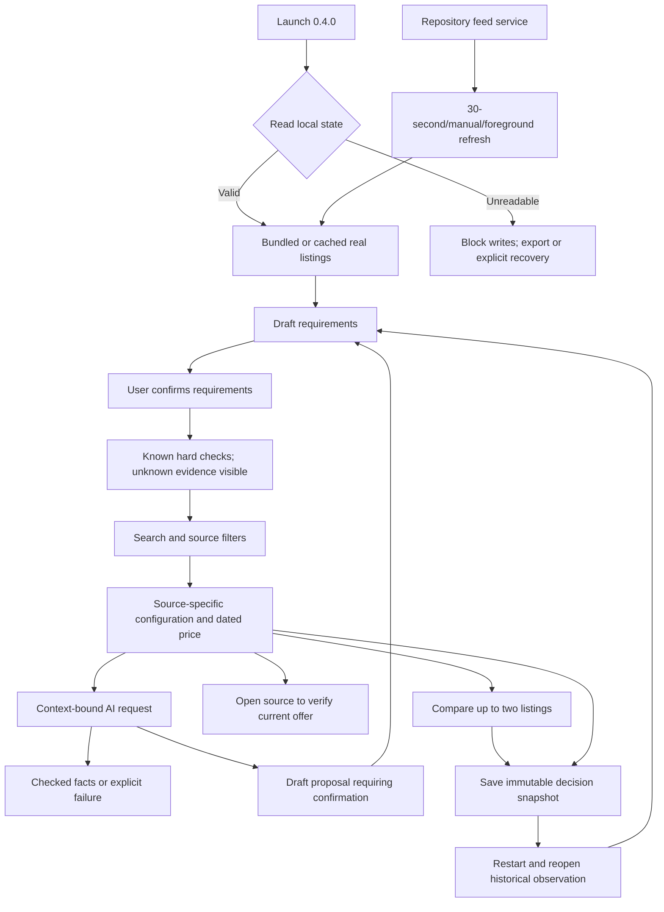

# Connected adviser implementation — 13 November 2026

The user explicitly requested implementation of a fuller real-data/refresh/AI version after the prebuild assessment, and selected the existing repository listings as the data source. Version 0.4.0 is a new implemented laptop journey and replaces the synthetic demo as the Android and web entry point. This authorization to implement does not invent source permission, current retail prices, paid AI authority, empirical observations or gate approval.

## Implemented behavior

- Seventy real source listings are imported with source-specific IDs, raw record hashes, HTTPS URLs and original observation times. No family-name deduplication or synthetic products are used in the new entry point. CPU/RAM/storage/OS data is taken from source fields; missing fields stay unknown.
- Confirmed budget, RAM/storage, OS and task requirements remain distinct from edits. Known hard failures precede ordering. Unknown exact identity, current stock, workload capability, fees, payable totals and affordability do not become a suitable/affordable verdict. Ranking is historical-price/name ordering among unresolved candidates; it is not measured workload suitability.
- Real-name/spec search, retailer filtering, ordering, excluded-result visibility, source detail, retailer linking, two-source-listing comparison and source-dated sharing are wired into the actual application.
- Saved decisions contain immutable configurations, prices, source dates, requirements and catalog revision. Reopen displays historical facts; re-evaluation requires a new explicit confirmation against the current catalog. Serialized reducers protect saves/deletes/requirements from lost updates; failed reads block ordinary writes; failed writes preserve prior state; recovery is explicit and original bytes can be exported.
- The service rereads the repository feed on every request. Android polls every 30 seconds when connected and checks on foreground/manual refresh. Changed catalog revisions invalidate advice and refresh current results; source failure retains the last good snapshot and is distinct from a successful empty catalog. No retailer fetcher was enabled.
- Following the user's later instruction, AI now runs on-device through ML Kit Prompt API and Android AICore (Gemini Nano). The native bridge checks availability, supports explicit model preparation/download, bounds input/output, times out inference and cancels coroutine work. Local output can select checked fact IDs or propose structured requirements; confirmed needs require user review. Prompt/context validation and cancellation are exercised with an injected bridge. There is no cloud fallback and no OpenAI key or spending authority is required. SDK dependency is pinned to Google's documented `com.google.mlkit:genai-prompt:1.0.0-beta4`; minimum Android API is 26. Expo Go and web do not contain the native bridge.
- Native configuration is generated through an Expo plugin: HTTPS by default, explicit local-development cleartext exceptions, backup disabled, obsolete storage/overlay permissions removed. The build regenerates native configuration and the catalog before assembly, then copies and hashes the handoff APK and a versioned `lua-adviser-0.4.0.apk`.



## Checks and evidence

`checks.json` records actual command execution. App tests execute 67 tests, including 27 catalog/storage/client/evidence/theme/quotation/i18n cases and seven local-AI bridge tests. The current service executes 16 HTTP/provider-budget/governance/pilot-evaluation tests with injected providers (`HTTP-REAL-01`–`07`, `BUDGET-01`–`02`, `PROVIDER-01`–`02`, `GOV-01`–`04`, `PILOT-01`). The original 17 research packs still execute all 158 required IDs (165 discovered tests); their overlap with ordinary app tests must not be summed as unique coverage. Existing demo-service and spike integration suites execute 2 and 3 tests separately. TypeScript and web compilation pass.

Native evidence is captured by `android-check.py` with explicit `ANDROID_SERIAL`. The locally available Resizable_Experimental x86-64 emulator was launched read-only/headless for these checks; this is emulated Android evidence, not physical-phone validation. JSON phase results, UIAutomator XML and PNGs preserve the observed launch, confirmed requirements, detail/save, history after restart, service connection, explicit missing-AI handling and comparison outcomes. Final build/source/APK hashes and per-phase outcomes are recorded in `manifest.json`.

A release-lint failure is retained in `native-build-final.log`: the new network-security XML initially omitted required `includeSubdomains` attributes. They were corrected in the Expo plugin, then the release build passed. An initial comparison smoke check is retained in `android-compare-before-scroll-fix.log`: switching tabs retained the previous scroll offset, hiding the comparison heading. The production-used ScrollView now resets on tab change; the native comparison check is rerun against the corrected APK. Earlier launch-command/log-path errors and intermediate APKs are not evidence of the final build.

Source and fixture hashes accompany current results. Older R00–R14 and APK reports remain historical; R00 package-input provenance was refreshed after changing the app scripts/version. Passing those original tests alone does not validate the new UI. Current native/device outcomes belong to this additive record; no unperformed R11 device cases were marked passed.

## What is still unavailable

1. **Successful on-device inference evidence.** Gemini Nano requires a compatible AICore device/runtime. Physical supported-device/model generation is unperformed unless specifically recorded in the final manifest. Emulator availability and controlled bridge results cannot establish model quality or successful physical inference. The earlier OpenAI credential request was cancelled when the user selected local AI. No key was used and no paid AI requests were made.
2. **Live retail updates.** The user selected repository listings. Their dates remain 11 November 2026. Refresh synchronizes file changes, not retailer checkout or stock. A permitted live source/feed is still needed for genuinely current prices. No new crawling/contact/spending was performed.
3. **Reviewed data and workload coverage.** Real source observations are not independently verified exact variants or capability measurements. The new app explicitly keeps these states unresolved; it does not manufacture evidence from product names or AI prose. A normalized record can also disagree with its own listing name; unreviewed identity remains visible.
4. **Public production operation.** No hosted HTTPS endpoint, per-user authentication, multi-process usage ledger, hardware-backed service-token storage, production staff review system, production database/backup/recovery deployment or store signing has been established. The backend is a local single-process service, and the release APK uses the development signing key.
5. **Empirical/readiness evidence.** Physical-phone/accessibility/performance matrices, buyers, independent reviewers, complete cost estimates and accountable G1–G4 decisions remain pending. Phone/PC advising, alerts and general quotation/OCR ingestion are outside the implemented laptop journey.

This is a functional real-listing adviser build with connected-service and AI code paths. It must not be described as a fully live, production-approved product while these dependencies are absent.

## Run

From `E:\test`:

```powershell
node --experimental-strip-types --env-file-if-exists=services/adviser/.env services/adviser/server.mjs
# In a second terminal, for the specifically intended Android target:
& "$env:LOCALAPPDATA\Android\Sdk\platform-tools\adb.exe" -s emulator-5580 reverse tcp:8788 tcp:8788
```

Save `http://127.0.0.1:8788` in app Settings. The APK works offline with bundled real observations; service refresh requires the configured backend; AI uses local AICore. For a remote server, configure a controlled HTTPS endpoint. No public deployment was performed.

Rebuild from the repository root:

```powershell
npm.cmd --prefix apps/adviser run check
npm.cmd --prefix apps/adviser test
node --experimental-strip-types --test services/adviser/server.test.mjs
npm.cmd --prefix apps/adviser run build:android -- -Offline
```

The service setup, AI limits and operating constraints are documented in `services/adviser/README.md` and `apps/adviser/README.md`.

## Local AI update

The user's later instruction selected local AI such as Gemini Nano instead of OpenAI. The Android entry point now calls `src/local-ai.ts` and the native `AdviserLocalAi` module. It does not call the cloud advice endpoint and does not need a data-service connection for AI. The previous OpenAI adapter tests and service-unavailable screenshots remain intermediate evidence rather than proof of the final local model path.

Native sources live under `apps/adviser/native/adviser/LocalAiModule.kt` and are copied/registered by a persisted Expo plugin. ML Kit Prompt is pinned to 1.0.0-beta4, Kotlin to 2.2.10, and minimum Android API to 26. A failed offline dependency resolution and the original Kotlin metadata mismatch are retained in `local-ai-build.log` and `local-ai-build-online.log`. No metadata checks were suppressed; the compiler was updated. Actual final build and emulator status are listed in `manifest.json`.

Model availability is checked before presenting download actions. Download is explicit and may consume network/storage; unsupported devices keep source facts available. The local output is constrained to checked fact IDs and draft requirements, with input/output bounds, timeout, stale-context rejection and coroutine cancellation. Successful Gemini Nano generation on compatible physical hardware remains unperformed unless specifically recorded. No OpenAI key was supplied or used, and no paid cloud AI calls occurred.

Primary reference verified on 13 November 2026: https://developers.google.com/ml-kit/genai/prompt/android/get-started (official SDK setup, status/download flow and API 26 minimum). See also https://developers.google.com/android/reference/kotlin/com/google/mlkit/genai/prompt/GenerativeModel for cancellation/resource lifecycle integration.

## Current native observation

The Gemini Nano APK builds successfully (`local-ai-build-kotlin-fixed.log`). On emulator-5580, the native bridge was present and reported the device/AICore model unavailable; the checked failure path preserved facts and requirements (`android-nano.log`, associated XML/PNG). This does not establish a successful generation. Comparison and repository-service connection also pass on that APK. A basic smoke run initially checked while AsyncStorage restoration was still in progress; its failure is preserved in `android-basic-nano-build.log`, and the harness now waits for the ready home state before checking the journey. The final per-phase result and artifact hash determine qualifying evidence rather than an older passed JSON.

The local-AI boundary review added NANO-07: model proposals containing additional factual fields (`price`, `productId`) were initially accepted by the requirements shape check. The requirements validator now allows only the declared fields. Failing-before and passing-after results are preserved in `local-ai-extra-fields-before.log` and `local-ai-extra-fields-after.log`; all current app/HTTP consumers were rerun.

## Handoff packaging and current artifact

Final native compilation and the complete repeatable packaging pipeline pass (`delivered-pipeline.log`). Windows initially refused an in-place overwrite of a mapped APK after a successful build (`local-ai-release-final.log`). Packaging now stages and verifies a temporary file, renames the previous artifact to a recoverable APK, publishes the new file, and skips rewriting identical hashes. The final pipeline rerun succeeds. The delivered versioned APK and compatibility handoff alias have identical hashes to native Gradle output.

The final APK content check confirms the native `AdviserLocalAi` bridge and ML Kit Prompt classes are present; the old `start-picker` and `synthetic-v1` bundle markers are absent (`apk-content-check.json`). `manifest.json` refuses native phase evidence from another APK hash. Current code executes 67 app tests (including `REAL-01`–`13`, `EVIDENCE-01`–`02`, `THEME-01`, `I18N-01`, `CLIENT-01`–`05`, `STORE-01`–`05`, `NANO-01`–`07`) and 16 current-service tests (including `GOV-01`–`04` and `PILOT-01`); original pack coverage remains separately identified. Native phases are `basic`, `compare`, `nano`, `source` and `outage`; their actual outcomes and artifact hashes are authoritative. The Nano phase verifies registered native availability/error handling, not successful generation on this unsupported emulator.

Test-created emulator and local service are stopped after collecting evidence. The APK can browse bundled listings offline; restart the documented service and configure the intended connection for source synchronization. On a compatible physical phone, local AI is independent of that service. No public deployment or store signing was performed.
