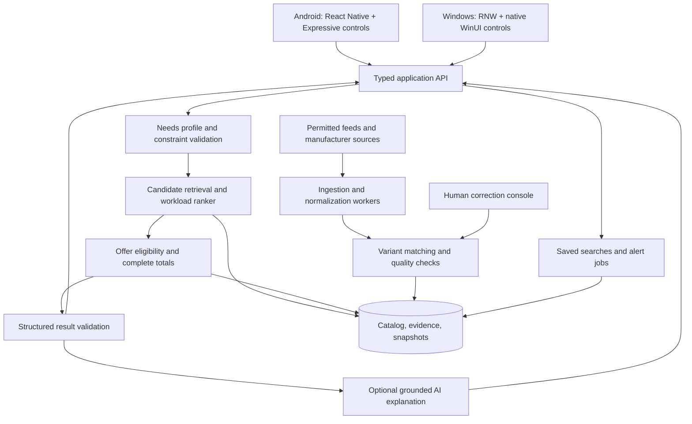

# Technical and design blueprint

Prepared 10 November 2026. This is a proposed architecture, not an implemented or benchmarked system. Scope: Vietnam, Windows desktop, Android, and later country expansion.

## 1. React Native feasibility and the two native design systems

React Native can share the application's domain models, API client, state transitions, validation, and much of its feature composition. It does not make two different native component systems interchangeable automatically.

### Windows: distinguish Composition from WinUI 3 controls

Microsoft's RNW architecture documentation says modern host components render through the Windows App SDK Composition layer rather than automatically using WinUI 3 XAML controls. [Architecture explanation](https://github.com/microsoft/react-native-windows-samples/blob/main/docs/new-architecture.md)

Microsoft's RNW 0.82 announcement documents Fabric-only operation and support for hosting native XAML controls through community modules. That is evidence of an integration mechanism, not proof that every required control works in this app. [RNW 0.82 announcement](https://devblogs.microsoft.com/react-native/%F0%9F%9A%80react-native-windows-v0-82-is-here/)

**Proposed route:** React Native for Windows using its current supported Fabric template, with a focused C++/WinRT native component package exposing the actual WinUI 3 controls required by the product. Keep a Windows-specific shell adapter and use WinUI navigation, selection, input, dialog, and status patterns. Validate shell/hosting boundaries rather than assuming every shell control can be dropped inside a React layout.

Native WinUI 3 is Windows-specific; Microsoft describes it as a native Windows desktop framework. [WinUI 3 overview](https://learn.microsoft.com/windows/apps/WinUI)

Do not use old `--useWinUI3` examples from historical RNW releases as the implementation recipe. Pin a mutually compatible React Native/RNW pair and Windows App SDK/toolchain after a spike. A release such as 0.82 demonstrates capability; this report does not assert it is the latest version or prescribe it for production.

If actual WinUI controls cannot meet shell, keyboard, accessibility, or performance requirements under RNW, reassess before feature implementation. A separate native WinUI front end would preserve backend contracts but reduce shared UI and TypeScript reuse. A Fluent-styled React implementation is another option only if the actual native-control requirement is relaxed; do not describe styling alone as native WinUI 3.

### Android: baseline Material 3 is not the entire Expressive system

Google documents Material 3 Expressive implementation in Jetpack Compose. [Android Material 3 guidance](https://developer.android.com/develop/ui/compose/designsystems/material3) React Native Paper's documentation establishes MD3/Material You support; that alone does not establish complete coverage of today's Expressive controls, motion, and accessibility behavior. [Paper MD3 guide](https://oss.callstack.com/react-native-paper/docs/guides/migration-guide-to-5.0)

**Proposed route:** React Native Android, semantic design tokens, and a focused Fabric component package in Kotlin for native Compose Material 3 Expressive controls. Use React primitives for suitable content/layout; use native adapters where exact component behavior is required. Audit each selected library against an explicit component inventory before adoption.

React Native documents Fabric native components, while Android documents `ComposeView` interoperability and composition lifecycle management. Together they support the proposed integration approach; they do not provide a prevalidated, drop-in RN Expressive kit. [Fabric components](https://reactnative.dev/docs/fabric-native-components-introduction), [Compose in Views](https://developer.android.com/develop/ui/compose/migrate/interoperability-apis/compose-in-views)

Test lifecycle owners, disposal, saved state, accessibility semantics, input method behavior, sizing, event routing, and recycled lists. Avoid one native composition/host per tiny text element; choose boundaries such as controls, coherent control groups, or feature surfaces and measure the cost.

### Mandatory feasibility slice

Build one complete vertical flow on both platforms before committing to the native library strategy:

1. Native search input and budget controls.
2. A virtualized result list with the same product data and selection semantics.
3. Native filter/selection UI, dialog or sheet, and navigation behavior.
4. Product detail and compare views.
5. Dark mode, large text, screen reader, keyboard/Back, resizing, and suspend/resume.
6. Signed release builds with a small benchmark fixture.

Document supported versions and build commands. Any unsupported third-party dependency must have a tested replacement or adapter. Do not assume Android navigation, animation, image, storage, analytics, or notification packages support RNW Fabric.

## 2. Share contracts and behavior; adapt rendering centrally

Use four layers:

| Layer | Examples | Sharing policy |
|---|---|---|
| Domain | NeedsProfile, Variant, Offer, evidence, money, compatibility | Shared TypeScript definitions; authoritative calculations on server |
| Feature behavior | Search state, comparison selection, onboarding, saved profiles | Shared hooks/controllers and state machines |
| Product components | RecommendationCard, OfferList, TradeoffList, EvidencePanel | Shared contract and content rules; adapt composition when needed |
| Platform controls/shell | Navigation, buttons, inputs, dialogs, sheets, focus | Windows and Android implementations behind one package |

React Native documents platform-specific files and detection; RNW documents corresponding Windows detection. [React Native platform code](https://reactnative.dev/docs/platform-specific-code.html), [RNW platform detection](https://microsoft.github.io/react-native-windows/docs/platform/)

Proposed structure:

```text
apps/
  adviser/                    # React Native application
    src/                      # Routes and platform-neutral feature composition
    android/                  # Android host and native build
    windows/                  # RNW host and native build
packages/
  domain/                     # Entities, money, units, validation contracts
  api-client/                 # Generated typed REST client and runtime schemas
  features/                   # Onboarding, search, recommendations, compare, saved
  design-tokens/              # Semantic tokens with platform mappings
  ui/                         # Public app-wide component contracts
    Button.android.tsx
    Button.windows.tsx
    AppShell.android.tsx
    AppShell.windows.tsx
  native-controls/            # Codegen specs + Kotlin/Compose and C++/WinRT code
  localization/               # Vietnamese and English strings/formatting
services/
  api/                        # Modular backend and recommendation orchestration
  ingestion/                  # Feed adapters and refresh workers
  admin/                      # Restricted catalog/evidence correction interface
docs/
  decisions/                  # Architecture and design decisions
```

This is a suggested future repository layout. No application folders have been scaffolded by this research task.

Do not create one enormous global state object. Keep server data in a query cache, draft profile state in its flow, and small persistent preferences in a separate store. Keep per-frame animation state native. Shared components must have stable props, independent state boundaries, and accessible states.

## 3. Global component inventory

| Component | Shared responsibilities | Platform adaptation |
|---|---|---|
| AppShell | Routes, destination names, selection, state restoration | WinUI navigation/panes; Android bar/rail and Back |
| AppButton / IconAction | Label, command, disabled/loading, accessibility | Native control appearance and focus/press behavior |
| SearchField | Query, debounce, clear, suggestions, empty state | Native input/IME and keyboard shortcuts |
| BudgetInput | Currency, integer validation, ceiling, accessible value | Native numeric input and supported range control |
| FilterGroup | Selection model, counts, clear/apply semantics | Windows side pane; Android adaptive sheet/pane |
| ProductSummary | Exact variant, category, permitted image, key facts | Density and layout, responsive to available width |
| RecommendationCard | Reason, meaningful tradeoffs, shortlist actions | Platform surfaces, emphasis, motion |
| PriceSummary | Money, total completeness, conditions, timestamp | Locale formatting and accessible announcements |
| OfferList | Seller, stock, warranty, price state, affiliate disclosure | Desktop rows vs mobile list and details |
| CompareView | Equal units, exact variants, differences, unknowns | Wide comparison grid vs mobile paired/category views |
| EvidencePanel | Claim-source links, test context, confidence/coverage | WinUI pane/dialog; Android sheet/detail surface |
| CompatibilityStatus | Compatible/incompatible/unknown and reasons | Icon plus text; never color alone |
| AsyncState | Initial loading, refreshing, empty, error, offline | Platform progress/status presentation |
| FeedbackAction | Wrong match, stale price, missing fact, useful advice | Appropriate input/dialog controls |

Every component needs a documented contract, usage examples, accessibility behavior, supported states, and regression fixtures. Feature screens should import the app's UI package instead of accessing third-party widgets directly. Keep platform checks inside adapters whenever practical.

Do not force one component onto unrelated tasks merely to maximize reuse. Unify meaning, behavior, and evidence presentation; allow density, navigation, and composition to fit the device.

## 4. Design language and adaptive layout

Map semantic tokens to native resources: `surface`, `surfaceRaised`, `textPrimary`, `textSecondary`, `accent`, `positive`, `caution`, `critical`, `focus`, spacing, type roles, and motion roles. Share intent, not identical corner radii or font metrics. Resolve Windows theme/accent/high-contrast resources and Android dynamic color with a fallback palette; verify contrast in all combinations.

**Windows:** resizable navigation panes, keyboard accelerators, visible focus, pointer/hover affordances, density appropriate for desk use, selectable/copyable content, and clear multi-column comparisons. Use materials such as Mica only where supported and appropriate; keep a readable solid fallback.

**Android:** Material 3 Expressive component hierarchy, purposeful emphasis and shape, adaptive navigation, touch targets, dynamic color, and limited native motion. Avoid continuous decorative animation or making primary information depend on motion. Support system Back, IME insets, rotation, and foldable resizing.

Proposed initial width bands, to validate against content rather than device labels:

- Compact: under 600 logical units; one content column and focused comparison.
- Medium: 600–999; navigation rail/pane and optional list-detail layout.
- Expanded: 1000 and above; persistent filters, results, and an optional detail panel.

These are app layout hypotheses, not universal Windows/Material thresholds. Account for DPI, text scaling, safe areas, input devices, and minimum control widths. A narrow Windows window should still work; an Android tablet should use its space.

Proposed primary destinations: Discover, Compare, Saved/Alerts, and Settings. Keep the adviser reachable from Discover; introduce PC Builder as a destination when the feature ships. Account synchronization is optional; guest browsing and local saved preferences should work.

Meet accessibility requirements throughout: TalkBack/Narrator, meaningful headings, screen-reader reading order, labels for changing prices, non-color statuses, larger text without clipping, reduced motion, Android minimum touch-target guidance, Windows high contrast, and complete keyboard operation. Validate native hosts and shared content together.

## 5. Backend architecture: begin with a modular monolith

Use one typed API service and isolated worker processes rather than premature microservices. Suggested baseline: TypeScript server, PostgreSQL, job queue, permitted object storage, and an optional cache. Framework choice is secondary to correct boundaries. Search can begin with indexed PostgreSQL filtering/full-text search; add a dedicated search index only when measured catalog size and query needs justify it.



API and model keys remain on the server. The client receives typed view models and approved purchase URLs, not database credentials or raw affiliate secrets. Restrict administrative permissions and track corrections.

Keep retrieval/ranking and explanation separable. If the AI provider fails, catalog browsing, offer comparison, and a rule-generated explanation should remain usable. If offers fail, do not present cached data as a newly verified quote.

## 6. Data model

| Entity | Essential fields |
|---|---|
| ProductFamily | Category, brand, family name, release/announcement state |
| ProductVariant | Manufacturer model/part number, region, configuration, canonical ID |
| SpecAssertion | Variant, field, typed value/unit, source, effective date, confidence/status |
| EvidenceSource | URL/provider ID, publication/retrieval dates, method, allowed-use policy |
| BenchmarkObservation | Exact tested configuration, tool/protocol version, conditions, metric, units |
| Merchant / Seller | Market, seller identity, delivery regions, support/warranty policies |
| Offer | Variant match, seller, condition, market, stock, eligibility, URL, policy reference |
| PriceObservation | Offer, amount/currency, shipping/tax status, discount terms, observed/expiry times |
| WorkloadRequirement | Application/version, platform/backend, task scale, hard/soft rules, source |
| CompatibilityRule | Component relation, conditions, verdict, rule version, evidence |
| NeedsProfile | Budget, tasks, weights, constraints, eligibility, locale, consent/preferences |
| RecommendationRun | Profile fingerprint, rule/model versions, catalog snapshot, offers, reasons |
| SavedSearch / Alert | User or local ID, criteria, threshold, cooldown, last event |

Store numeric specifications in canonical units and preserve the original value. Store money as integer minor units with currency/exponent metadata; VND has no fractional display in the normal cash-price UI. Do not assume all currencies share an exponent. Format in the client; calculate in tested server code.

Schema.org Product/Offer offers useful vocabulary for prices, currency, availability, shipping, and merchant policies; structured markup is an ingestion aid where permitted, not a permission grant or an authoritative truth guarantee. [Product](https://www.schema.org/Product), [Offer](https://www.schema.org/Offer)

Use source-aware resolution: manufacturer evidence for supported configuration, retailer evidence for an offer, and specific test evidence for measured behavior. Conflicts should be reviewable. Never silently overwrite a verified variant with a lower-confidence listing.

## 7. Proposed API contracts and workflow

Initial endpoints:

```text
GET  /v1/catalog/variants?market=VN&category=laptop&...
GET  /v1/catalog/variants/{id}
GET  /v1/catalog/variants/{id}/offers?deliveryArea=...
POST /v1/recommendation-runs
GET  /v1/recommendation-runs/{id}
POST /v1/compare
POST /v1/feedback
POST /v1/saved-searches                 # optional authenticated synchronization
POST /v1/builds/validate                # PC phase
```

`POST /recommendation-runs` should accept a validated needs profile or a message for extraction. Return a run ID and a state such as `needs_clarification`, `ranking`, `results_ready`, `complete`, or `failed`. Serve the structured shortlist as soon as it is ready; explanations can arrive in a later response or stream. Use an operation ID/idempotency key and cancellation so rapid edits do not create duplicate paid model calls.

Example response shape, intentionally without fabricated device data:

```ts
type RecommendationItem = {
  variantId: string;
  offerId?: string;
  role: 'best_fit' | 'lowest_eligible_price' | 'alternative';
  eligibility: 'pass' | 'fail' | 'unknown';
  suitability: { value?: number; rulesVersion: string };
  evidenceCoverage: 'high' | 'medium' | 'low';
  advantages: Array<{ text: string; evidenceIds: string[] }>;
  disadvantages: Array<{ text: string; evidenceIds: string[] }>;
  unknowns: string[];
  quote?: {
    totalMinor: number;
    currency: string;
    complete: boolean;
    verifiedAt: string;
    expiresAt: string;
    conditions: string[];
  };
};
```

Use runtime validation as well as TypeScript. Store source fields and calculation inputs behind evidence IDs. An authenticated user should only access their private profiles and saved searches. Treat merchant redirects as an allowlisted server-generated mapping; do not allow the model to supply arbitrary URLs.

## 8. Caching, ingestion, and responsiveness

Use cache keys including market, delivery area, exact variant, condition, eligibility context, and schema/rules version. Avoid cross-user profile leakage. Separate slow-changing specifications from volatile price and stock observations.

Illustrative initial refresh policies, subject to provider contracts and measured reliability:

- Specs: update on source changes or a daily/weekly schedule.
- Normal offers: 30–60 minutes; frequently changing promotions may need a tighter cadence.
- Buying options: request a refresh on open when provider limits allow it.
- Price-sensitive recommendation: exclude offers after their source-specific eligibility window.

These are proposed operating policies, not guarantees or known retailer update rates. Track ingestion lag, source outages, freshness, and matching errors. Use retries/backoff and per-provider rate limits. Keep last-known observations accessible with honest timestamps while withholding fresh-price claims.

Client approach: paginated/virtualized lists, stable item keys, correctly sized cached images, bounded query-cache persistence, lazy-loaded detail charts/evidence, debounced search, request cancellation, and fine-grained subscriptions. Start with supported React Native list primitives; choose a third-party list only after validating RNW support. Keep expensive ranking, graph search, and bulk normalization off the client JS thread.

TanStack Query is a reasonable candidate for server state, with separate persistence, network-status, and app-lifecycle adapters per platform. Its query API supports network modes; it does not establish that every React Native integration package supports Windows. [Query reference](https://tanstack.com/query/latest/docs/framework/react/reference/functions/useQuery)

Use native/appropriate UI-thread animation mechanisms that have been verified on the target platform. Memoize measured bottlenecks, not every element by default. Never make one root state change rerender an entire catalog. Batch updates during explanation generation rather than refreshing the list for each token.

## 9. Performance targets and measurement

All values below are **proposed pilot acceptance targets**, not measured results. Establish separate baselines on a representative lower/mid-range Android phone and an integrated-graphics Windows laptop with 8 GB RAM and SSD; record exact hardware/OS/toolchain before testing. Also validate a larger Windows display and an Android tablet/foldable layout.

| Metric | Proposed target | Measurement boundary |
|---|---|---|
| Local input feedback | p95 under 100 ms | Input event to visible acknowledgement |
| Warm cached results | p95 under 300 ms | Open saved/search view to useful cached content |
| Cold usable shell | p95 under 2 s Android; under 3 s Windows | Process launch to interactive navigation; network data reported separately |
| Online filtered result view | p95 under 1.5 s | Submit to useful results, excluding a clarification exchange; controlled network |
| Server deterministic ranking | p95 under 500 ms | Validated profile to shortlist; warmed local data/cache |
| AI explanation | p95 under 8 s | Accepted completed profile to complete explanation; model/network recorded |
| Scrolling | Aim for 60 Hz with under 5% missed frames on fixture | A fixed result-list journey on 60 Hz baseline; inspect long stalls |

Count timeouts and errors, not only successful fast calls. Report cold and warm results separately and use enough samples for tail latency; a handful of runs cannot establish p95. Budget memory after the native-host spike; first require bounded growth and no sustained leak across repeated navigation cycles.

React Native's performance guide explains JS/UI-thread frame constraints and recommends release-build measurement. [Performance guide](https://reactnative.dev/docs/performance) Android Macrobenchmark exposes startup/frame metrics. [Macrobenchmark metrics](https://developer.android.com/topic/performance/benchmarking/macrobenchmark-metrics)

Measure Android with Macrobenchmark/Perfetto and RN profiling; Windows with ETW/WPA or suitable native profiling plus RN instrumentation. Use production-like signed release builds. Record device, thermal/power state, refresh rate, data fixture, network profile, server version, model, and cache state. A desktop cross-build alone does not prove performance on ARM64 hardware.

Test network loss, slow connections, stale offers, large catalogs, rapid filter changes, and AI timeouts. Offline mode can support cached browsing and saved profiles, while clearly indicating that current price/stock cannot be verified.

## 10. Privacy, observability, and maintenance

Collect only what improves recommendations. Request a broad delivery area before any precise location. Keep optional account creation separate from browsing. Avoid transmitting workplace documents or sensitive project descriptions to an AI provider; use structured workload summaries where possible. Give users control over saved profiles and conversation retention.

Record operational events without raw personal prompts by default: recommendation state transitions, latency, invalid variant matches, missing mandatory evidence, refresh failures, model validation errors, and report corrections. Provide an explanation of why an item was selected and a correction mechanism.

CI should build Windows and Android release variants, check domain/API schemas and calculations, run catalog/offer contract fixtures, and test critical user flows. Native controls require platform accessibility/interaction testing. Maintain a dependency support matrix and upgrade RN/RNW/native packages together in a dedicated branch, supported by the feasibility fixtures.
